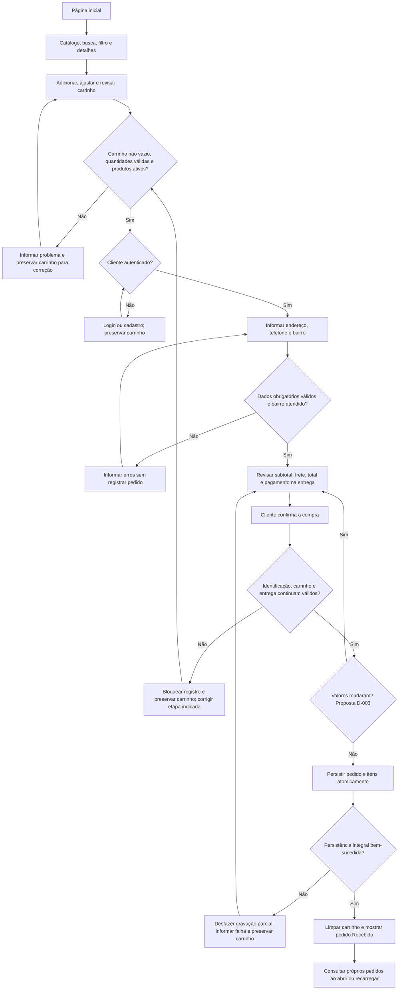

# Fluxo de compra do cliente

**Semana 2 — especificação para revisão.** Este documento descreve comportamento futuro; as telas e ações abaixo ainda não existem na aplicação.

Referências: [requisitos](requisitos.md), [regras de negócio](regras-negocio.md) e [protótipos](prototipos.md). Os identificadores RF indicam os requisitos relacionados; as decisões D-003 e D-004 permanecem pendentes de validação.

## Fluxo principal

O visitante pode consultar produtos e montar um carrinho vinculado à sessão. A identificação do cliente é obrigatória para concluir a compra.

| Passo | Ação e resultado esperado | Requisitos |
| --- | --- | --- |
| 1 | Cliente acessa a página inicial e encontra acesso ao catálogo futuro. | RF-001 |
| 2 | Entra no catálogo e visualiza somente produtos ativos, com nome, preço e unidade. | RF-001 |
| 3 | Pesquisa pelo nome ou filtra por categoria. | RF-002, RF-003 |
| 4 | Consulta as informações de um produto disponível. | RF-004 |
| 5 | Adiciona produtos ao carrinho da sessão, com quantidade inteira positiva. | RF-009 |
| 6 | Ajusta quantidades ou remove itens, se necessário. Valores inválidos são rejeitados. | RF-010, RF-011 |
| 7 | Consulta itens, quantidades, preços unitários e subtotal calculado no servidor. | RF-012 |
| 8 | Inicia a finalização. O sistema exige carrinho não vazio e verifica quantidades e disponibilidade. | RF-013 |
| 9 | Se ainda não estiver autenticado, realiza login. Se precisar criar conta, a proposta D-004 é cadastrar e retornar ao login; após autenticação, retoma a finalização com o carrinho preservado. | RF-005, RF-006, RF-007 |
| 10 | Informa endereço e telefone de contato. A proposta de endereço contém rua/logradouro, número e complemento opcional; o tratamento explícito de endereço sem número e as validações detalhadas dependem de D-004. | RF-014 |
| 11 | Seleciona um bairro entre os previamente atendidos. O servidor rejeita qualquer bairro fora da lista. | RF-015 |
| 12 | Confere produtos, quantidades, subtotal, taxa fixa de entrega e total. Os valores vêm do servidor. | RF-016 |
| 13 | Confere que o pagamento será na entrega, única modalidade desta versão, sem seleção de meios adicionais. | RF-017 |
| 14 | Confirma a compra. O servidor verifica novamente identificação, carrinho, quantidades, disponibilidade, endereço, telefone, bairro e valores; somente então registra o pedido integralmente. | RF-007, RF-013 a RF-018 |
| 15 | Após persistência válida do pedido e de todos os itens, o carrinho é esvaziado e o cliente visualiza identificação, resumo e estado **Recebido**. Falha de persistência não produz confirmação. | RF-018, RF-025 |
| 16 | Posteriormente, acessa seus próprios pedidos e consulta o estado atual ao abrir ou recarregar a página. | RF-008, RF-026 |

O campo de identificação de login (proposta: nome de usuário e senha) e os dados de cadastro ainda dependem de D-004; este fluxo não define e-mail, CPF ou outros dados como obrigatórios.

## Cálculo e registro

```text
Subtotal = soma(quantidade × preço unitário)
Total = subtotal + taxa fixa de entrega
```

Os valores monetários usam representação decimal. Cálculos e validações ocorrem no servidor; valores enviados pelo navegador não determinam o preço, o frete ou o total do pedido. Antes do registro, o servidor revalida a disponibilidade, que corresponde ao controle manual de produto ativo/inativo, sem estoque quantitativo nesta versão.

O pedido guarda os preços unitários praticados, as quantidades, o subtotal, a taxa de entrega e o total da compra. Alterações posteriores no catálogo ou no frete não modificam esses valores já registrados. A criação do pedido e de seus itens deve ser atômica: ou todos são persistidos, ou nenhum registro parcial permanece. O carrinho só pode ser limpo após a persistência integral bem-sucedida.

**Proposta pendente D-003:** se preço ou frete mudar entre a revisão e a confirmação, reapresentar os valores atuais e exigir nova confirmação. Nunca registrar silenciosamente um total divergente daquele apresentado ao cliente. Esta política precisa de validação antes da implementação.

Não há bairros reais ou valor definitivo de frete definidos aqui. A lista de atendimento e a taxa fixa dependem das decisões comerciais registradas na [documentação de requisitos](requisitos.md).

## Fluxos alternativos

| Situação | Comportamento esperado | Retomada |
| --- | --- | --- |
| Carrinho vazio | Informar “Seu carrinho está vazio” e impedir a finalização; não criar pedido. | Voltar ao catálogo e adicionar itens. |
| Quantidade inválida | Rejeitar zero, negativos, frações e valores não numéricos; explicar que a quantidade deve ser um inteiro positivo. Não aplicar a alteração inválida nem registrar pedido. | Corrigir a quantidade; usar a ação de remover para excluir um item. |
| Produto indisponível | Se estiver inativo ao adicionar ou na revalidação, informar o produto afetado e impedir sua compra. Se já estiver no carrinho, manter os itens para correção; não concluir silenciosamente sem ele. | Remover o item indisponível e revisar o carrinho. |
| Bairro não atendido | Rejeitar bairro fora da lista, inclusive valor adulterado enviado diretamente ao servidor; não criar pedido. | Selecionar um bairro atendido correspondente ao endereço real ou interromper a compra. |
| Usuário não autenticado | Direcionar à identificação antes de concluir; falha no login/cadastro mantém o carrinho e apresenta erro. Um envio direto de confirmação sem autenticação também é bloqueado. | Após identificação válida, retornar à finalização com o carrinho preservado. |
| Dados obrigatórios ausentes | Destacar campos obrigatórios não preenchidos e impedir o registro. O complemento é opcional; validações detalhadas constam da decisão D-004. | Corrigir os campos e revisar o pedido. |
| Valores alterados após a revisão | Pela proposta D-003, apresentar novamente subtotal, frete e total atualizados, sem efetivar a confirmação anterior. | Exigir nova confirmação do cliente. |
| Falha na criação do pedido | Informar que o pedido não foi registrado, desfazer qualquer gravação parcial e manter o carrinho. Não exibir número de pedido confirmado nem estado de sucesso. | Permitir nova tentativa de confirmação, repetindo todas as validações. |

## Diagrama do fluxo

As validações agrupadas abaixo incluem os casos da tabela anterior. A verificação de mudança de valores representa a proposta D-003, ainda em revisão.



## Verificação futura do fluxo

O fluxo será aceito quando uma compra válida gerar um pedido completo com valores preservados, e cada alternativa impedir um registro inválido sem limpar o carrinho. A consulta posterior deve impedir acesso a pedidos de outro cliente e exibir o estado persistido mais recente ao abrir ou recarregar a página, sem atualização em tempo real ou notificações nesta versão.

Implementação prevista: identificação na Semana 4, catálogo na Semana 5, carrinho na Semana 6, finalização e confirmação na Semana 7 e acompanhamento na Semana 8. A rastreabilidade completa está em [requisitos.md](requisitos.md).
