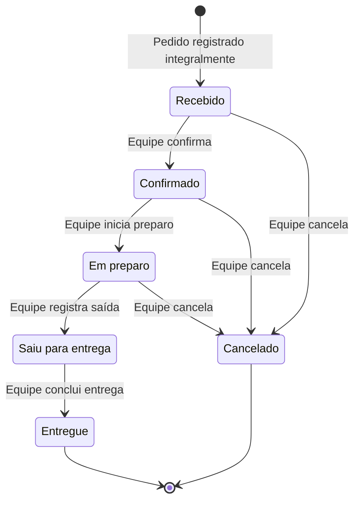

# Fluxo operacional dos pedidos

**Semana 2 — especificação para revisão.** Este documento orienta a operação futura do supermercado. Nenhum painel, estado ou ação operacional foi implementado nesta etapa.

Referências: [requisitos](requisitos.md), [regras de negócio](regras-negocio.md), [fluxo de compra](fluxo-compra.md) e [protótipos](prototipos.md). Requisitos principais: RF-022 a RF-024, RF-008 e RF-026.

## Atores e informações de atendimento

Somente integrantes autenticados e autorizados da equipe podem consultar os pedidos para atendimento e alterar seus estados. Um cliente autenticado consulta apenas seus próprios pedidos e não altera o estado de nenhum pedido. Visitantes não acessam a área operacional nem finalizam compras.

Ao abrir um pedido, a equipe precisa visualizar:

- Identificação e data/hora do pedido; identificação do cliente e telefone de contato.
- Endereço: rua/logradouro, número, complemento quando informado e bairro atendido. A proposta de aceitar indicação explícita de endereço sem número e os detalhes de validação dependem de D-004.
- Itens, quantidades inteiras positivas, unidades e preços unitários registrados na compra.
- Subtotal, taxa fixa de entrega, total e indicação de pagamento na entrega.
- Estado atual e somente as ações de transição permitidas naquele momento.

Os valores exibidos vêm do pedido registrado, preservando os preços praticados na compra, sem recalcular a partir dos preços atuais do catálogo. Não há controle quantitativo de estoque, integração financeira ou registro de pagamento adicional neste fluxo.

## Fluxo principal de atendimento

| Passo | Ação | Resultado |
| --- | --- | --- |
| 1 | Cliente conclui uma compra válida e o sistema persiste integralmente pedido e itens. | Pedido nasce em **Recebido** e fica disponível na relação da equipe. |
| 2 | Equipe autorizada abre o pedido e consulta cliente, contato, endereço, itens e valores. | Obtém os dados necessários ao atendimento; a consulta não altera o estado. |
| 3 | Equipe confirma o atendimento. | **Recebido → Confirmado**. |
| 4 | Equipe inicia a separação e preparação dos itens. | **Confirmado → Em preparo**. |
| 5 | Equipe registra a saída do pedido para entrega. | **Em preparo → Saiu para entrega**. |
| 6 | Equipe registra a conclusão da entrega. | **Saiu para entrega → Entregue**. |

O estado inicial **Recebido** significa que o pedido foi registrado pelo sistema. A mudança para **Confirmado** indica a confirmação operacional pela equipe.

## Transições e cancelamento

| Estado atual | Próximo estado permitido | Cancelamento pela equipe |
| --- | --- | --- |
| Recebido | Confirmado | Permitido: Recebido → Cancelado. |
| Confirmado | Em preparo | Permitido: Confirmado → Cancelado. |
| Em preparo | Saiu para entrega | Permitido: Em preparo → Cancelado. |
| Saiu para entrega | Entregue | Bloqueado após a saída. |
| Entregue | Nenhum: estado terminal. | Bloqueado. |
| Cancelado | Nenhum: estado terminal. | Nenhuma nova transição. |

O cancelamento é realizado exclusivamente pela equipe autorizada antes da saída para entrega. O pedido permanece registrado com estado **Cancelado** e com seus itens e valores preservados para consulta. Não há ação de cancelamento pelo cliente nesta versão.

## Operações bloqueadas e tratamento de erros

| Tentativa | Resposta esperada |
| --- | --- |
| Usuário sem permissão acessa a operação ou envia alteração diretamente ao servidor. | Negar acesso e manter o pedido inalterado. Ocultar botões não substitui a verificação no servidor. |
| Cliente tenta consultar pedido pertencente a outro usuário. | Negar acesso sem revelar dados do pedido. |
| Cliente tenta modificar o estado de um pedido, inclusive o próprio. | Rejeitar a alteração e preservar o estado atual. |
| Equipe tenta pular uma etapa, retroceder ou enviar estado não previsto. | Rejeitar a transição e informar que a ação não é permitida a partir do estado atual. |
| Equipe tenta cancelar pedido em Saiu para entrega ou Entregue. | Rejeitar o cancelamento e preservar o estado. |
| Equipe tenta reabrir ou alterar pedido Entregue ou Cancelado. | Rejeitar a transição, pois são estados terminais. |
| Uma página antiga apresenta ação incompatível com o estado já atualizado por outro integrante. | Validar o estado persistido no servidor, rejeitar a transição desatualizada e apresentar o estado atual para nova consulta. |
| Falha ao salvar uma mudança de estado. | Manter o estado anterior, informar a falha e não apresentar confirmação de sucesso. |

As transições devem ser verificadas no servidor no momento da alteração. Uma repetição de ação que já não corresponde ao estado atual não pode fazer o pedido avançar duas etapas.

## Acompanhamento pelo cliente

Após o registro da compra, o cliente vê **Recebido** na confirmação. Ao abrir ou recarregar a relação ou o detalhe de seus pedidos, vê o estado mais recente persistido, inclusive **Cancelado**, quando aplicável. A página já aberta não se atualiza automaticamente. Não há notificações nem atualização em tempo real nesta versão.

O cliente visualiza os próprios itens e valores registrados, mas não recebe ações de avanço, retrocesso ou cancelamento. As mesmas restrições de propriedade do pedido valem para o acesso direto por identificador.

## Verificação futura do fluxo

- Percorrer a sequência completa e verificar cada mudança no acompanhamento do cliente após recarga.
- Cancelar separadamente pedidos em Recebido, Confirmado e Em preparo; confirmar que permanecem consultáveis e não podem ser reabertos.
- Rejeitar todas as transições ausentes da tabela, inclusive cancelamento após a saída e ações feitas a partir de uma página desatualizada.
- Bloquear alterações por clientes e usuários sem autorização, e bloquear consulta de pedidos de terceiros.
- Preservar estado e dados anteriores quando uma atualização falhar.

A operação e o acompanhamento serão implementados na Semana 8, com permissões apoiadas pelo cadastro interno e pela autenticação previstos nas Semanas 3 e 4. A rastreabilidade completa está em [requisitos.md](requisitos.md).
