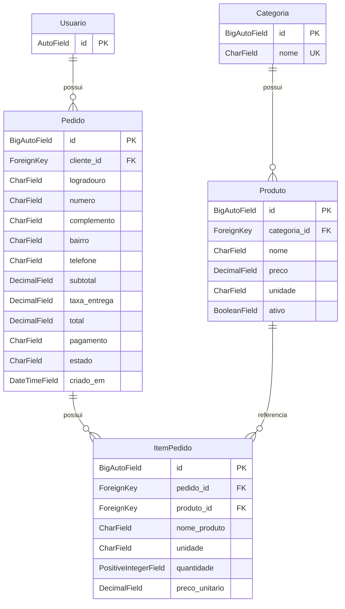

# Semana 3 — Modelagem de dados e Django Admin

## Objetivo e fontes funcionais

Implementar a persistência de categorias, produtos, pedidos e itens na aplicação `principal`, mantendo o monólito Django e o SQLite local. O cadastro interno utiliza o Django Admin. Pedidos e itens têm estrutura de armazenamento para as próximas etapas; não existe fluxo público de compra ou operação de pedidos nesta entrega.

A modelagem considera os cinco documentos da Semana 2: [requisitos](../semana-02/requisitos.md), [regras de negócio](../semana-02/regras-negocio.md), [fluxo de compra](../semana-02/fluxo-compra.md), [fluxo operacional](../semana-02/fluxo-pedidos.md) e [protótipos](../semana-02/prototipos.md). As regras de produto obrigatório, preço não negativo, disponibilidade manual e histórico orientam a estrutura; fórmulas, criação atômica e transições permanecem para suas semanas previstas.

Esta documentação corresponde a [models.py](../../principal/models.py) e à [migration 0001_initial](../../principal/migrations/0001_initial.py). Publicação no GitHub ou implementação não substituem a aprovação do supervisor. As decisões D-001 a D-007 continuam pendentes conforme a documentação de origem.

## Entidades, campos e tipos

Os quatro modelos possuem `id` como chave primária `BigAutoField`, gerada pelo Django conforme `PrincipalConfig.default_auto_field`. Todos os campos têm `null=False`. Apenas `Pedido.complemento` permite texto vazio (`blank=True`); não é necessário armazenar `NULL` para representar sua ausência.

### Categoria — `principal_categoria`

| Campo | Tipo Django | Finalidade e configuração |
| --- | --- | --- |
| `id` | `BigAutoField` | Identificador automático, chave primária. |
| `nome` | `CharField(max_length=100, unique=True)` | Nome obrigatório, sem duplicação exata. |

A unicidade evita duas categorias com o mesmo nome armazenado. Na configuração atual do SQLite, diferencia maiúsculas e minúsculas; não há normalização de acentos ou espaços. A ordenação padrão é por nome.

### Produto — `principal_produto`

| Campo | Tipo Django | Finalidade e configuração |
| --- | --- | --- |
| `id` | `BigAutoField` | Identificador automático, chave primária. |
| `categoria` | `ForeignKey(Categoria)` | Obrigatória; `PROTECT`; relação reversa `categoria.produtos`. |
| `nome` | `CharField(max_length=150)` | Nome obrigatório. |
| `preco` | `DecimalField(max_digits=10, decimal_places=2)` | Preço não negativo, sem valor comercial padrão. |
| `unidade` | `CharField(max_length=30)` | Unidade/embalagem obrigatória, em texto livre. |
| `ativo` | `BooleanField(default=True)` | Disponibilidade manual; não representa quantidade em estoque. |

Nome de produto não é único: unidades ou apresentações diferentes podem ter o mesmo nome. Não há lista fechada de unidades, pois o conteúdo comercial depende de D-005. A ordenação padrão é por nome.

### Pedido — `principal_pedido`

| Campo | Tipo Django | Finalidade e configuração |
| --- | --- | --- |
| `id` | `BigAutoField` | Identificador automático, chave primária. |
| `cliente` | `ForeignKey(settings.AUTH_USER_MODEL)` | Usuário obrigatório; `PROTECT`; relação reversa `usuario.pedidos`. |
| `logradouro` | `CharField(max_length=200)` | Logradouro usado na entrega. |
| `numero` | `CharField(max_length=20)` | Número como texto, permitindo futura indicação explícita de endereço sem número. |
| `complemento` | `CharField(max_length=150, blank=True)` | Informação opcional de endereço. |
| `bairro` | `CharField(max_length=100)` | Nome registrado na compra; não configura área atendida. |
| `telefone` | `CharField(max_length=30)` | Contato registrado na compra, sem formato comercial presumido. |
| `subtotal` | `DecimalField(max_digits=12, decimal_places=2)` | Subtotal histórico não negativo, sem default. |
| `taxa_entrega` | `DecimalField(max_digits=12, decimal_places=2)` | Taxa histórica não negativa, sem default. Não define o frete comercial. |
| `total` | `DecimalField(max_digits=12, decimal_places=2)` | Total histórico não negativo, sem default. |
| `pagamento` | `CharField(max_length=20)` | Única opção `na_entrega` / “Na entrega”, também seu valor padrão. |
| `estado` | `CharField(max_length=20)` | Opções de `EstadoPedido(TextChoices)`; padrão `recebido`. |
| `criado_em` | `DateTimeField(auto_now_add=True)` | Momento de criação preenchido pelo Django. |

O projeto mantém o usuário padrão do Django, sem modelo personalizado. Endereço e telefone ficam no pedido para registrar os dados daquela compra. Seus campos e limites são uma decisão técnica provisória compatível com D-004; não determinam os formulários públicos futuros. A ordenação padrão apresenta os mais recentes primeiro, por `-criado_em` e `-id`.

| Valor armazenado de `estado` | Rótulo |
| --- | --- |
| `recebido` | Recebido |
| `confirmado` | Confirmado |
| `em_preparo` | Em preparo |
| `saiu_para_entrega` | Saiu para entrega |
| `entregue` | Entregue |
| `cancelado` | Cancelado |

As opções restringem os valores possíveis. Não implementam a sequência de transições, os estados terminais ou as permissões operacionais previstas para a Semana 8.

### ItemPedido — `principal_itempedido`

| Campo | Tipo Django | Finalidade e configuração |
| --- | --- | --- |
| `id` | `BigAutoField` | Identificador automático, chave primária. |
| `pedido` | `ForeignKey(Pedido)` | Obrigatório; `PROTECT`; relação reversa `pedido.itens`. |
| `produto` | `ForeignKey(Produto)` | Obrigatório; `PROTECT`; relação reversa `produto.itens_pedido`. |
| `nome_produto` | `CharField(max_length=150)` | Nome histórico informado para a compra. |
| `unidade` | `CharField(max_length=30)` | Unidade histórica informada para a compra. |
| `quantidade` | `PositiveIntegerField` | Quantidade inteira, com mínimo 1. |
| `preco_unitario` | `DecimalField(max_digits=10, decimal_places=2)` | Preço histórico não negativo, sem default. |

A ordenação padrão é por `id`. Não há restrição única entre pedido e produto: o agrupamento dos produtos no carrinho será responsabilidade da etapa futura. Não existe campo calculado ou armazenado para o valor da linha.

## Relacionamentos e cardinalidades

Cada produto pertence a exatamente uma categoria. Cada pedido pertence a exatamente um usuário. Cada item pertence a exatamente um pedido e referencia exatamente um produto. No sentido inverso, categoria, usuário, pedido e produto podem ter zero ou muitos registros associados.

`Usuario` representa `settings.AUTH_USER_MODEL`, atualmente `auth.User`; seus demais campos padrão foram omitidos do diagrama. No SQLite, as colunas de chave estrangeira recebem o sufixo `_id`. O esquema permite temporariamente um pedido sem itens: a exigência de compra não vazia e o registro integral pertencem ao checkout da Semana 7.

## Restrições e alcance das validações

Os campos monetários usam `MinValueValidator(Decimal('0.00'))`; a quantidade usa `MinValueValidator(1)`. A validação do modelo verifica obrigatoriedade, comprimentos, opções, precisão decimal, unicidade e restrições. O Admin utiliza os formulários nativos do Django.

`save()` não executa `full_clean()` automaticamente. Em código que cria instâncias manualmente, a validação deve ser chamada explicitamente quando desejada; os testes distinguem `ValidationError` do modelo de `IntegrityError` do banco. Não há sobrescrita de `save()`, sinais ou validação que grave outros registros. [Referência oficial de validação do modelo](https://docs.djangoproject.com/en/5.2/ref/models/instances/#validating-objects).

O banco possui chaves primárias, chaves estrangeiras obrigatórias, `NOT NULL`, unicidade de `Categoria.nome` e estes dez `CheckConstraint`:

| Nome da restrição | Condição garantida |
| --- | --- |
| `categoria_nome_preenchido` | `Categoria.nome` diferente de `''`. |
| `produto_preco_nao_negativo` | `Produto.preco >= 0`. |
| `produto_textos_preenchidos` | Nome e unidade de produto diferentes de `''`. |
| `pedido_valores_nao_negativos` | Subtotal, taxa de entrega e total maiores ou iguais a zero. |
| `pedido_entrega_preenchida` | Logradouro, número, bairro e telefone diferentes de `''`. |
| `pedido_pagamento_na_entrega` | Pagamento igual a `na_entrega`. |
| `pedido_estado_valido` | Estado entre os seis valores de `EstadoPedido`. |
| `item_quantidade_positiva` | Quantidade maior ou igual a 1. |
| `item_preco_nao_negativo` | Preço unitário maior ou igual a zero. |
| `item_historico_preenchido` | Nome histórico e unidade diferentes de `''`. |

`PositiveIntegerField` também gera no SQLite a verificação nativa de quantidade não negativa; o CHECK adicional eleva esse mínimo para 1. `CheckConstraint` é aplicado pelo banco mesmo quando a gravação não chama `full_clean()`. [Referência oficial de restrições](https://docs.djangoproject.com/en/5.2/ref/models/constraints/#checkconstraint).

Os limites destas garantias são:

- Os CHECKs de texto rejeitam a cadeia vazia; não fazem normalização nem rejeitam sozinhos uma cadeia composta de espaços. Comprimentos máximos são validados pelo Django, não pelo tipo `varchar` do SQLite.
- `max_digits` e `decimal_places` são limites de validação dos campos, não uma garantia universal de qualquer escrita direta no SQLite. `DecimalField` representa valores como `Decimal` no Python. [Referência oficial de DecimalField](https://docs.djangoproject.com/en/5.2/ref/models/fields/#decimalfield).
- SQLite não possui tipo decimal nativo e pode usar representação de ponto flutuante para esses valores. Não foi adicionado CHECK de igualdade `total = subtotal + taxa_entrega`, que dependeria dessa aritmética. Cálculos futuros deverão usar `Decimal` no Python. [Limites oficiais de decimais no SQLite](https://docs.djangoproject.com/en/5.2/ref/databases/#decimal-handling).
- A quantidade usa o campo inteiro nativo do Django. Ele pode converter uma entrada numérica antes da validação; não se promete rejeição estrita de toda fração passada diretamente em Python ou SQL. A validação de entrada dos formulários futuros deverá rejeitar quantidades fracionárias, conforme RN-006.

Não há cálculo automático, conferência entre subtotal e itens, exigência de ao menos um item por pedido, captura automática dos preços ou criação atômica de pedido e itens nesta etapa. São regras das Semanas 6 e 7, não garantias já fornecidas pelo armazenamento.

## Exclusão de registros

| Relacionamento | `on_delete` | Justificativa |
| --- | --- | --- |
| `Produto.categoria` | `PROTECT` | Categoria referenciada não pode ser excluída deixando produtos sem classificação. |
| `Pedido.cliente` | `PROTECT` | Preserva a identificação do cliente de pedidos existentes. |
| `ItemPedido.pedido` | `PROTECT` | Impede apagar por essa relação um pedido que possui itens históricos. |
| `ItemPedido.produto` | `PROTECT` | Impede excluir um produto referenciado por item; sua retirada da oferta ocorre por inativação. |

Nas exclusões pelo ORM, `PROTECT` gera `ProtectedError` quando existem referências. Esse comportamento é implementado pelo Django; não é uma cláusula SQL `ON DELETE PROTECT`. As chaves estrangeiras do SQLite também impedem referências órfãs com sua verificação habilitada pela conexão Django. [Referência oficial de on_delete e PROTECT](https://docs.djangoproject.com/en/5.2/ref/models/fields/#django.db.models.ForeignKey.on_delete).

Registros sem referências podem ser excluídos quando o usuário possui a permissão correspondente. `PROTECT` não impede excluir diretamente um item nem torna os campos históricos imutáveis por SQL ou código privilegiado. Não há exclusão em cascata nos quatro relacionamentos do domínio. Pedidos e itens não são expostos no Admin desta etapa.

## Preservação do histórico

`ItemPedido.nome_produto`, `unidade` e `preco_unitario` armazenam valores próprios, independentes dos campos atuais de `Produto`. Alterar nome, unidade ou preço do cadastro não atualiza os itens existentes. `Pedido` também guarda endereço, telefone, subtotal, taxa e total sem recalculá-los a partir de dados atuais.

Nesta semana, esses valores devem ser informados explicitamente ao criar registros no código de teste. Sua captura automática e consistente será implementada na Semana 7. A estabilidade após alterações de produto é testada; não há promessa de imutabilidade absoluta contra edição direta dos registros históricos.

## Cadastro interno, migrations e verificação

Em `/admin/`, `CategoriaAdmin` lista identificador/nome, pesquisa por nome e ordena por nome. `ProdutoAdmin` lista identificador, nome, categoria, preço, unidade e atividade; pesquisa por nome e filtra categoria/atividade. Ambos oferecem cadastro e edição nativos, sem alterações visuais. Entre as entidades do domínio, somente `Categoria` e `Produto` estão registrados.

O Django exige usuário ativo com `is_staff` para entrar no Admin, além das permissões de cada operação. Superusuário ativo tem as permissões administrativas. Não há credenciais fixas, usuários de demonstração ou formulário público de clientes. Usuários necessários aos testes são criados apenas no banco temporário. As instruções para criação manual de superusuário local estão no [README](../../README.md#semana-3--modelagem-de-dados-e-django-admin).

A migration `principal/0001_initial.py` depende do modelo de usuário configurado e cria as quatro tabelas, suas relações e restrições. Não contém carga de dados comerciais ou alteração das tabelas das semanas anteriores. A adaptação do SQLite pode recriar as tabelas novas durante a adição de restrições; o banco local existente é preservado.

Os comandos de `migrate`, `showmigrations principal`, `check`, `makemigrations --check --dry-run`, `test` e `pip check` estão no README. A suíte preserva o teste da página inicial e acrescenta persistência, validação do modelo, restrições do banco, exclusões protegidas, histórico e operações/permissões do Admin. Os exemplos de dados e usuários dos testes não são cadastros comerciais do banco local.

Na validação desta entrega, `check` não identificou problemas; a migration `0001_initial` foi aplicada e aparece como `[X]`; `makemigrations --check --dry-run` não encontrou alterações; uma nova execução de `migrate` não encontrou pendências; e `pip check` não encontrou inconsistências. Os 37 testes passaram: 23 de modelos, 13 do Admin e o teste original da página inicial. A inspeção do SQLite confirmou integridade, ausência de referências órfãs, quatro tabelas do domínio vazias e nenhum usuário criado no banco local.

## Requisitos atendidos nesta etapa

| Referência | Cobertura da Semana 3 |
| --- | --- |
| RF-019 | Cadastro, edição, consulta, busca e proteção de categorias pelo Admin. |
| RF-020 | Cadastro e manutenção de produtos; campos obrigatórios, preço decimal, proteção de referências e histórico independente. |
| RF-021 | Parcial: campo `ativo` e controle manual no Admin; aplicação no catálogo e na compra permanece para as Semanas 5–7. |
| RF-022 | Parcial: autenticação e autorização no cadastro interno. Contas públicas e operação de pedidos continuam para as Semanas 4 e 8. |
| RNF-004 | Parcial: estrutura monetária, restrições de armazenamento e valores históricos independentes. Cálculos e criação atômica permanecem para a Semana 7. |
| RNF-007 | Monólito mantido, migrations versionáveis, documentação e testes com dependências existentes. |
| RN-001, RN-002, RN-004 e RN-014 | Campos do produto, não negatividade, relações protegidas e armazenamento histórico, com os limites de SQLite e de captura descritos acima. |
| RN-003 | Parcial: disponibilidade manual armazenada; nenhuma oferta pública ou validação de compra implementada. |

## Decisões técnicas e pendências

Foi mantida uma única aplicação. Os tamanhos dos campos, a unicidade exata de categoria e o uso de `PROTECT` são decisões técnicas para uma base simples e revisável. O endereço é armazenado no pedido conforme a proposta D-004, sem criar tabela de endereços ou lista de bairros. Os campos monetários não possuem preços, frete ou totais padrão presumidos.

| Decisão | Situação nesta entrega |
| --- | --- |
| D-001 | Bairros atendidos continuam indefinidos; `Pedido.bairro` guarda apenas texto histórico. |
| D-002 | Valor fixo da entrega pendente; `taxa_entrega` não possui default. |
| D-003 | Política para mudança de valores entre revisão e confirmação pendente; sem checkout implementado. |
| D-004 | Campos e formatos públicos pendentes; representação mínima de endereço/telefone adotada provisoriamente, sem máscaras comerciais. |
| D-005 | Categorias, produtos, preços, unidades e identificação comercial reais pendentes; nenhum dado comercial permanente foi inventado. |
| D-006 | O usuário solicitou expressamente Django Admin para o cadastro desta semana. Isso autoriza sua implementação, sem presumir aprovação do supervisor ou escolher a futura interface operacional. |
| D-007 | Aprovação geral do supervisor permanece pendente. Os documentos da Semana 2 foram preservados como especificação daquela entrega. |

Não há indefinição que impeça criar esta estrutura revisável. As decisões comerciais e os formatos definitivos deverão ser validados antes das funcionalidades que dependem deles. Catálogo público, contas de clientes, carrinho, checkout, transições e acompanhamento não fazem parte da Semana 3.
