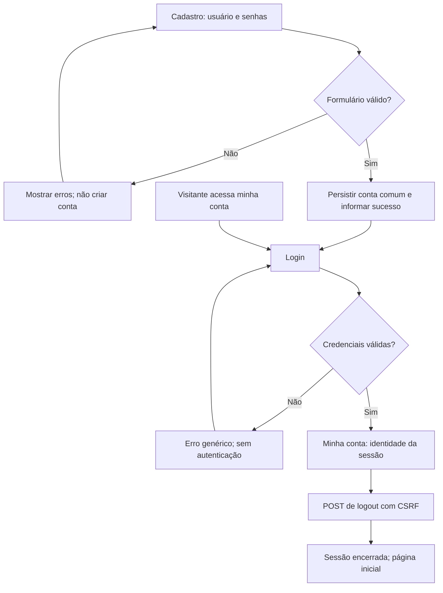

# Semana 4 — Conta do cliente e autenticação

## Objetivo e requisitos

Permitir o ciclo **cadastro → login → área autenticada → logout**, usando a [autenticação nativa do Django](https://docs.djangoproject.com/en/5.2/topics/auth/default/) no monólito existente. A implementação permanece na aplicação `principal`, com Django Templates e SQLite. A área `/minha-conta/` demonstra a identidade e a sessão do cliente; não oferece edição de perfil nem informações de pedidos.

As referências são os [requisitos](../semana-02/requisitos.md), as [regras de negócio](../semana-02/regras-negocio.md), o [fluxo de compra](../semana-02/fluxo-compra.md), o [fluxo dos pedidos](../semana-02/fluxo-pedidos.md) e a [modelagem da Semana 3](../semana-03/modelagem-dados.md). Os documentos anteriores preservam o estado das respectivas entregas.

| Referência | Alcance nesta semana |
| --- | --- |
| RF-005 | Cadastro público de conta comum, com validação e mensagens. |
| RF-006 | Login, sessão e logout. A integração com carrinho ainda depende da Semana 6. |
| RF-007 | Identificação disponível; proteção da confirmação de compra será integrada na Semana 7. |
| RF-022 e RN-021 | Cadastro sem privilégios administrativos, proteção da área privada e preservação das permissões do Admin. Autorização sobre pedidos depende da Semana 8. |
| RNF-001 a RNF-003 | Credenciais e sessões nativas, controle de acesso no servidor e proteção CSRF nas submissões. |
| RNF-005 e RNF-007 | Formulários com rótulos e erros, navegação simples, arquitetura e ambiente reproduzível preservados. |

## Estratégia e formulários

O projeto mantém `auth.User`, sem modelo personalizado, backend próprio ou biblioteca adicional. `Pedido.cliente` continua apontando para `settings.AUTH_USER_MODEL`; nenhum campo ou relacionamento da Semana 3 foi alterado e não há nova migration.

- Cadastro: `UserCreationForm` nativo, usado diretamente pela view `cadastro`, com `username`, `password1` e `password2`.
- Login: `LoginView` e seu `AuthenticationForm` nativo.
- Logout: `LogoutView` nativa.
- Área privada: view `minha_conta`, protegida por `login_required` e `never_cache`.

Não foi necessário criar `principal/forms.py` ou uma nova aplicação. Os validadores de senha já configurados no projeto continuam verificando semelhança com os dados do usuário, tamanho mínimo, senhas comuns e senhas inteiramente numéricas. O cadastro usa `form.save()`, que aplica o hashing nativo; nenhuma senha em texto puro é gravada pelo fluxo.

## Rotas e fluxo

| Rota | Nome Django | Comportamento |
| --- | --- | --- |
| `/` | `principal:inicio` | Página pública; HTTP 200. |
| `/cadastro/` | `principal:cadastro` | GET exibe o cadastro; POST valida e cria uma conta comum. |
| `/login/` | `principal:login` | GET exibe o login; POST autentica com credenciais válidas. |
| `/minha-conta/` | `principal:minha_conta` | Usuário autenticado recebe HTTP 200; visitante recebe redirecionamento para `/login/?next=/minha-conta/`. |
| `/logout/` | `principal:logout` | POST válido encerra a sessão e redireciona para `/`; GET retorna HTTP 405. |
| `/admin/` | `admin:index` | Admin existente; visitante é encaminhado ao login administrativo. |

### Cadastro

Os três campos são obrigatórios. Nome já utilizado, senhas diferentes ou inválidas impedem a criação do usuário. O formulário mantém o nome de usuário informado e apresenta os erros junto aos campos; as senhas não são preenchidas novamente após erro.

O formulário não aceita campos para definir `is_staff`, `is_superuser`, grupos ou permissões. A conta criada é comum, sem privilégios administrativos. CPF, e-mail, telefone e endereço não são exigidos.

Após salvar, a aplicação apresenta **“Cadastro realizado com sucesso. Entre com seu usuário e senha.”** e redireciona para `/login/`. Não há login automático nem confirmação por e-mail.

### Login

O formulário solicita nome de usuário e senha. Credenciais inválidas não criam sessão autenticada; a mensagem de erro não distingue usuário inexistente de senha incorreta. A autenticação nativa também impede o login de usuário inativo.

O destino padrão é `/minha-conta/`. Quando existe `next`, a `LoginView` aplica a validação nativa de host e esquema; destinos externos inseguros não substituem o destino padrão. O template preserva `next` na submissão do formulário. Não há redirecionamento manual baseado diretamente em parâmetros recebidos.

### Logout

O botão **Sair** é um formulário HTML POST com token CSRF. Um POST válido elimina a sessão autenticada e redireciona à página inicial. A `LogoutView` utiliza `redirect_field_name=None`, para que um parâmetro `next` enviado pelo cliente não altere esse destino. Acesso posterior a `/minha-conta/` volta a exigir login. GET não encerra a sessão; POST sem proteção CSRF válida é rejeitado com HTTP 403.



## Sessões, segurança e isolamento

`LOGIN_URL`, `LOGIN_REDIRECT_URL` e `LOGOUT_REDIRECT_URL` apontam, respectivamente, para `principal:login`, `principal:minha_conta` e `principal:inicio`. As sessões usam o backend nativo de banco, na tabela `django_session` do SQLite. A autenticação permanece entre requisições por meio do cookie de sessão, sem enviar a senha em cada navegação.

O login nativo renova a chave da sessão anônima e preserva seus dados. Isso fornece a base para RN-005, mas não implementa nem comprova um carrinho, que pertence à Semana 6. O logout limpa os dados da sessão. As opções nativas `HttpOnly` e `SameSite=Lax` do cookie foram mantidas; o projeto continua configurado exclusivamente para desenvolvimento local com HTTP e `DEBUG=True`.

Os formulários de cadastro, login e logout utilizam CSRF. O escape padrão dos templates protege a exibição do nome de usuário. A página privada utiliza `never_cache` para não permitir armazenamento de sua resposta em cache. Senhas não aparecem na navegação, nos valores reapresentados pelos formulários ou na página da conta.

A identidade mostrada em `/minha-conta/` vem exclusivamente de `request.user`, sem buscar uma conta por identificadores enviados pelo navegador. Dois clientes de teste independentes mantêm sessões distintas e recebem apenas a própria identificação. Encerrar uma sessão não encerra a outra.

Essa separação não equivale a autorizar consultas de pedidos ainda inexistentes. Nas Semanas 7 e 8, será necessário exigir autenticação no checkout, associar a compra ao usuário da sessão e filtrar pedidos pelo usuário autenticado no servidor. Um identificador recebido do navegador não prova propriedade. A equipe precisará das permissões correspondentes para operar pedidos, separadamente da área do cliente.

O Django Admin mantém suas verificações de usuário ativo, `is_staff` e permissões da operação. O cadastro público não concede essas permissões. Categoria e Produto continuam sendo os únicos modelos do domínio registrados; Pedido e ItemPedido não recebem painel antecipado.

## Templates e navegação

- `templates/base.html`: navegação e mensagens compartilhadas. Visitantes encontram login e cadastro; usuários autenticados encontram minha conta, identificação e o formulário de logout.
- `templates/registration/cadastro.html`: formulário de cadastro, instruções de senha e erros.
- `templates/registration/login.html`: formulário de login, erros, destino `next` e link para cadastro.
- `templates/principal/minha_conta.html`: identificação da sessão, confirmação de sessão ativa e acesso à página inicial; herda o logout da base.

Os formulários usam `form.as_div`, com rótulos e erros nativos. O CSS acrescenta somente o necessário para a apresentação dos campos, mensagens e navegação. Não há JavaScript nem frontend definitivo.

## Testes e verificação

Na validação inicial, `manage.py check` não encontrou problemas, `makemigrations --check --dry-run` não encontrou alterações e os 37 testes existentes passaram em 0,995 s.

A suíte específica está em `principal/test_auth.py`. Ela cobre cadastro, persistência, hashing, validações, ausência de privilégios, login, redirecionamento seguro, sessão, logout por POST, CSRF e isolamento de clientes. A suíte completa também executa os 37 testes anteriores: página inicial, modelos, integridade e Admin. Usuários e dados de teste são criados exclusivamente no banco temporário do Django.

Na validação final de 18/10/2026, os **61 testes passaram em 7,586 s**, sem falhas ou erros: 37 testes anteriores e 24 novos de autenticação. `manage.py check` não encontrou problemas; `makemigrations --check --dry-run` não detectou alterações; `migrate` não encontrou migrations pendentes; e `pip check` não encontrou dependências inconsistentes. Todos os comandos terminaram com código de saída 0. A comparação SHA-256 confirmou que o banco SQLite local permaneceu intacto.

```powershell
.\.venv\Scripts\python.exe manage.py check
.\.venv\Scripts\python.exe manage.py makemigrations --check --dry-run
.\.venv\Scripts\python.exe manage.py migrate
.\.venv\Scripts\python.exe manage.py test principal.test_auth
.\.venv\Scripts\python.exe manage.py test
.\.venv\Scripts\python.exe -m pip check
```

As verificações consideram os efeitos no banco e na sessão, além dos status HTTP: cadastro inválido não persiste usuário, cadastro válido não autentica automaticamente, senha é verificada por hash, login válido mantém autenticação, logout a remove e tentativas sem CSRF não executam a alteração. Os testes também confirmam a troca da chave da sessão no login com preservação de um marcador genérico do visitante, a inutilização do cookie anterior após logout e o retorno obrigatório à página inicial mesmo quando um `next` é enviado no logout.

## Critérios de aceite e limites

| Critério | Situação | Implementação e evidência |
| --- | --- | --- |
| Cadastro | Concluído | Formulário nativo, conta persistida sem privilégios, erros por campo e retorno ao login; testes de cadastro aprovados. |
| Login | Concluído | Credenciais válidas autenticam; inválidas não autenticam; `next` inseguro é bloqueado; testes de login e sessão aprovados. |
| Logout | Concluído | POST com CSRF encerra a sessão; GET e POST sem CSRF não a encerram; testes de logout aprovados. |
| Proteção da área autenticada | Concluído | `login_required` verifica a sessão no servidor; testes de visitante e cliente em `/minha-conta/` aprovados. |
| Isolamento de sessões | Concluído | Identificação baseada em `request.user`; testes com dois clientes independentes aprovados. |
| Permissões administrativas | Concluído | Novos clientes sem permissões de equipe; testes de acesso e regressão do Admin aprovados. |
| Autorização de checkout e pedidos | Não implementado; previsto para as Semanas 7 e 8 | Nenhuma rota fictícia criada e nenhuma autorização futura declarada concluída. |

As escolhas de usuário/senha/confirmação e retorno ao login, propostas em D-004, foram solicitadas expressamente para esta implementação. Formatos de endereço e telefone continuam para o checkout. Essa autorização de implementação não substitui a aprovação formal do supervisor; D-007 e as decisões comerciais continuam externas à validação técnica.

Não foram implementados catálogo, busca de produtos, carrinho, checkout, criação ou histórico público de pedidos, operação ou transições, pagamento online, edição de perfil, alteração/recuperação de senha, confirmação por e-mail, login social, JWT, API ou deploy. Não houve mudança de arquitetura, modelos, migrations ou dependências. As próximas semanas permanecem fora desta entrega.
