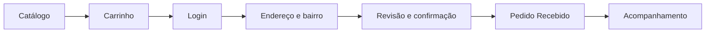
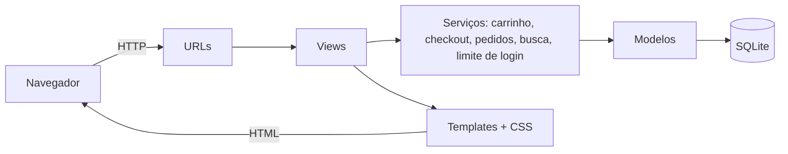
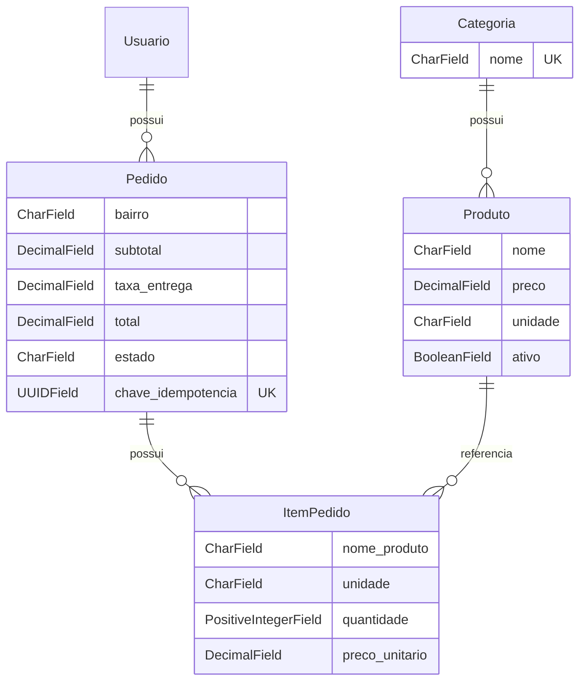
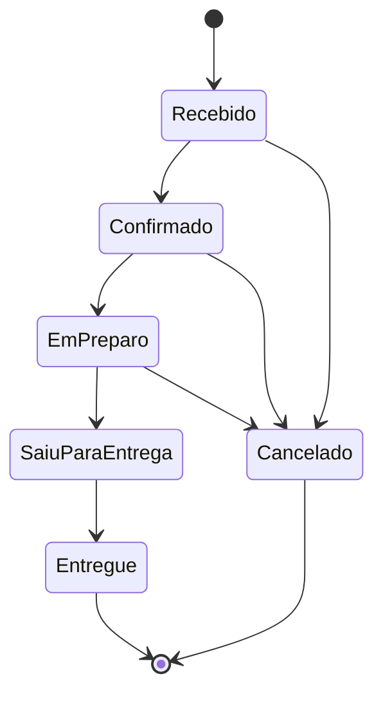

# Apresentação do sistema — estrutura dos slides

**Sistema de Pedidos Online para Supermercado com Entrega**

Este arquivo contém a estrutura completa da apresentação. Para cada slide há o título, o
conteúdo, o elemento visual e as notas de quem apresenta.

**Por que não há um arquivo `.pptx`.** Não havia ferramenta disponível para gerar um `.pptx`:
`python-pptx` não estava instalado em nenhum Python da máquina, e o Node.js não tinha
`pptxgenjs`. Nada foi instalado, como determinado. O conteúdo pode ser transposto para
PowerPoint, Google Slides ou LibreOffice Impress.

**Fontes das informações.** Todas as informações vêm do código e dos documentos do projeto. As
capturas de tela estão em [imagens/](imagens/) e foram obtidas do próprio sistema em execução,
com dados fictícios. Os diagramas vêm dos documentos das Semanas 2 e 3; o de modelagem foi
atualizado com o campo acrescentado na Semana 7.

**Orientações gerais:**

- no máximo cinco tópicos curtos por slide;
- uma imagem ou um diagrama por slide;
- tempo estimado de 15 a 20 minutos, mais a demonstração.

---

## Slide 1 — Capa

**Conteúdo**

- Sistema de Pedidos Online para Supermercado com Entrega
- Projeto de estágio em desenvolvimento web
- Autor, orientador, instituição e data: **[preencher]**

**Elemento visual:** [imagens/c01_inicio.png](imagens/c01_inicio.png), recortada no cabeçalho
e no título.

**Notas:** apresentar o tema e o formato (sistema web desenvolvido ao longo de 12 semanas).
Os dados institucionais devem ser preenchidos por quem apresenta.

---

## Slide 2 — Contextualização e objetivo

**Conteúdo**

- Projeto acadêmico de estágio, planejado em 12 semanas.
- Objetivo: permitir que clientes consultem produtos, montem um carrinho e façam pedidos com
  entrega e pagamento na entrega.
- A equipe do supermercado acompanha os pedidos e atualiza seus estados.
- Ambiente acadêmico: catálogo, bairro e taxa de entrega são fictícios.

**Elemento visual:** linha do tempo das semanas, baseada no README:

| Semanas | Etapa |
|---|---|
| 1–2 | Fundação e requisitos |
| 3 | Modelagem |
| 4 | Autenticação |
| 5 | Catálogo |
| 6 | Carrinho |
| 7 | Finalização da compra |
| 8 | Pedidos |
| 9 | Testes |
| 10 | Interface |
| 11 | Segurança e validação |
| 12 | Documentação |

**Notas:** deixar claro desde o início que os dados comerciais são fictícios e aprovados apenas
para a demonstração.

---

## Slide 3 — Problema

**Conteúdo**

- O cliente precisa consultar os produtos disponíveis e seus preços antes de comprar.
- O pedido precisa registrar itens, quantidades, valores e endereço sem erros nem duplicidade.
- A equipe precisa de uma lista organizada dos pedidos e de um registro claro do andamento.
- O cliente precisa consultar o andamento do próprio pedido, sem acessar dados de outras pessoas.

**Elemento visual:** quatro ícones simples, um para cada necessidade (catálogo, pedido, equipe,
acompanhamento).

**Notas:** estes são os problemas que o escopo da Semana 2 tratou. Não citar estatísticas de
mercado, que não fazem parte do projeto.

---

## Slide 4 — Solução proposta

**Conteúdo**

- Catálogo público com pesquisa e filtro por categoria.
- Carrinho para visitantes e clientes, com valores calculados pelo servidor.
- Finalização com endereço, bairro atendido, taxa fixa e pagamento na entrega.
- Área do cliente para consultar os próprios pedidos.
- Painel da equipe para atualizar os estados dos pedidos.

**Elemento visual:** fluxo de compra da Semana 2, simplificado (ver
[fluxo-compra.md](../semana-02/fluxo-compra.md)):

**Notas:** destacar o que **não** faz parte da versão: pagamento online, integração com meios de
pagamento, controle de estoque, rastreamento e notificações.

---

## Slide 5 — Tecnologias utilizadas

**Conteúdo**

- Python 3.14.7 e Django 5.2.19 (versão LTS).
- SQLite como banco de dados.
- Django Templates, HTML e CSS próprios, sem framework de JavaScript.
- Dependências fixadas em `requirements.txt`: Django, asgiref, sqlparse e tzdata.
- Testes com o framework de testes do Django.

**Elemento visual:** tabela simples tecnologia → finalidade.

**Notas:** a escolha de um monólito Django com renderização no servidor reduz a complexidade e
mantém todas as regras no servidor.

---

## Slide 6 — Arquitetura e estrutura do sistema

**Conteúdo**

- Arquitetura monolítica MVT (Model–View–Template) do Django.
- Projeto `supermercado`: configurações e separação entre desenvolvimento e produção
  (`settings.py`, `ambiente.py`).
- Aplicação `principal`: modelos, views, formulários e templates.
- Regras de negócio em módulos de serviço: `carrinho.py`, `checkout.py`, `pedidos.py`,
  `busca.py` e `limite_login.py`.

**Elemento visual:** diagrama da estrutura implementada:

**Notas:** as views apenas recebem a requisição e apresentam o resultado. Cálculos, permissões
e transições ficam nos serviços.

---

## Slide 7 — Modelagem de dados

**Conteúdo**

- `Categoria` → `Produto`: cada produto pertence a uma categoria.
- `Pedido` pertence a um usuário e guarda endereço, valores, pagamento e estado.
- `ItemPedido` guarda nome, unidade e preço do momento da compra (histórico preservado).
- Exclusões protegidas e restrições de integridade no banco.
- Chave de idempotência única por tentativa de compra.

**Elemento visual:** diagrama de [modelagem-dados.md](../semana-03/modelagem-dados.md),
com o campo `chave_idempotencia` acrescentado na Semana 7:

**Notas:** a cópia dos dados no `ItemPedido` garante que mudanças no catálogo não alterem pedidos
antigos.

---

## Slide 8 — Cadastro e autenticação

**Conteúdo**

- Cadastro e login nativos do Django; senhas armazenadas com hash (PBKDF2).
- Senha com no mínimo 12 caracteres, que não pode ser comum, parecida com o usuário ou somente
  numérica.
- Limite de tentativas de login: 5 falhas por usuário e IP, ou 30 por IP, em 15 minutos, com
  bloqueio temporário.
- Logout somente por formulário com proteção CSRF; o carrinho é limpo ao sair.

**Elemento visual:** [imagens/c06b_cadastro_senha_curta.png](imagens/c06b_cadastro_senha_curta.png).

**Notas:** o cadastro cria somente contas de cliente; privilégios enviados no formulário são
ignorados. O login do Django Admin tem o mesmo limite de tentativas.

---

## Slide 9 — Catálogo e busca de produtos

**Conteúdo**

- Somente produtos ativos aparecem e podem ser comprados.
- A pesquisa ignora maiúsculas, minúsculas e acentos ("agua" encontra "Água sanitária").
- Filtro por categoria, que pode ser combinado com a pesquisa.
- Ordem alfabética coerente ("Água" entre os nomes com A).
- Cartões responsivos com nome, categoria, preço e unidade.

**Elemento visual:** [imagens/c03_busca_agua.png](imagens/c03_busca_agua.png).

**Notas:** a busca com acentos foi uma falha encontrada nos testes-piloto (F-01) e corrigida sem
alterar o banco. O texto é normalizado na consulta ao SQLite.

---

## Slide 10 — Carrinho e checkout

**Conteúdo**

- O carrinho guarda na sessão apenas produtos e quantidades; os preços vêm sempre do banco.
- Subtotal, taxa e total são calculados no servidor com decimais exatos.
- Somente bairros configurados são aceitos; o total tem limite de R$ 5.000,00.
- O pedido e seus itens são gravados em uma única transação.
- Um envio repetido não cria um segundo pedido.

**Elemento visual:** [imagens/c12_checkout.png](imagens/c12_checkout.png) e
[imagens/c14_confirmacao.png](imagens/c14_confirmacao.png).

**Notas:** na demonstração, o bairro "Bairro Ficticio de Teste" e a taxa de R$ 5,00 existem
somente em desenvolvimento; a produção não usa esses valores. Valores alterados no navegador são
ignorados (verificado nos testes).

---

## Slide 11 — Gerenciamento e acompanhamento de pedidos

**Conteúdo**

- Todo pedido nasce **Recebido**.
- A equipe autorizada confirma, inicia o preparo, registra a saída e conclui a entrega.
- O cancelamento é possível até **Em preparo**; **Entregue** e **Cancelado** são finais.
- Cliques repetidos e páginas desatualizadas não avançam o pedido duas vezes.
- O cliente vê o estado ao abrir ou recarregar o pedido.

**Elemento visual:** diagrama de estados de [fluxo-pedidos.md](../semana-02/fluxo-pedidos.md),
que confere com a tabela de transições do código:

Imagem de apoio: [imagens/e02_detalhe_recebido.png](imagens/e02_detalhe_recebido.png).

**Notas:** os estados registram etapas do atendimento; o sistema não executa nem rastreia a
logística física.

---

## Slide 12 — Segurança e controle de acesso

**Conteúdo**

- Permissões verificadas no servidor:
  - visitante não acessa áreas privadas;
  - cliente vê somente os próprios pedidos;
  - a equipe precisa de permissões específicas.
- Proteção CSRF em todas as alterações; páginas com dados pessoais não ficam em cache.
- A chave secreta foi retirada do código; o ambiente é declarado com `DJANGO_ENV`.
- A produção exige HTTPS, hosts definidos e cache compartilhado.
- Auditoria de segurança na Semana 11, com correções e testes.

**Elemento visual:** [imagens/c17_acesso_negado_cliente.png](imagens/c17_acesso_negado_cliente.png).

**Notas:** citar os resultados verificados:

- pedido de outro cliente responde 404, igual a um pedido inexistente;
- cliente recebe 403 ao tentar alterar estados;
- tentativas de SQL injection e de XSS não tiveram efeito.

A implantação real ainda depende de infraestrutura (ver slide 16).

---

## Slide 13 — Responsividade e acessibilidade

**Conteúdo**

- CSS mobile-first, com pontos de quebra em 40, 64 e 80 rem.
- No celular, as tabelas viram cartões, mantendo a semântica para leitores de tela.
- Link "Pular para o conteúdo", foco visível e áreas de toque de pelo menos 44 px.
- Botões repetidos com nomes acessíveis que identificam o produto.
- Medições no Chrome com emulação real de 360, 390, 768, 1024 e 1440 px.

**Elemento visual:** [imagens/m01_catalogo_celular.png](imagens/m01_catalogo_celular.png) ao
lado de [imagens/c02_catalogo.png](imagens/c02_catalogo.png).

**Notas:** não afirmar conformidade com a WCAG, porque não houve avaliação formal. Nas medições
automatizadas não houve rolagem horizontal, valores quebrados nem alvos de toque menores que
44 px.

---

## Slide 14 — Testes realizados e resultados

**Conteúdo**

- 418 testes automatizados aprovados, sem avisos.
- Testes-piloto de ponta a ponta e instalação em ambiente limpo aprovados.
- Fluxo completo por HTTP real, do cadastro até a equipe registrar a entrega.
- Demonstração manual do fluxo do cliente feita pelo estudante.

**Elemento visual:** tabela com a distribuição dos testes por módulo:

| Área | Testes |
|---|---|
| Finalização da compra (`test_checkout`) | 91 |
| Carrinho (`test_carrinho`) | 59 |
| Pedidos (`test_pedidos`) | 46 |
| Interface (`test_interface`) | 35 |
| Configuração e senhas (`test_configuracao`) | 32 |
| Catálogo (`test_catalogo`) | 25 |
| Autenticação (`test_auth`) | 24 |
| Modelos (`test_models`) | 23 |
| Limite de login (`test_limite_login`) | 18 |
| Busca com acentos (`test_busca_acentos`) | 16 |
| Admin (`test_admin`) | 13 |
| Testes-piloto (`test_piloto`) | 11 |
| Segurança (`test_seguranca`) | 11 |
| Dados demonstrativos (`test_dados_demonstracao`) | 7 |
| Entrega demonstrativa (`test_entrega_demonstrativa`) | 6 |
| Página inicial (`tests`) | 1 |
| **Total** | **418** |

**Notas:**

- **Mutações:** parte dos testes foi conferida com mutações, isto é, retirando a proteção para
  confirmar que o teste falha.
- **Falhas encontradas no piloto:** busca e ordenação com acentos (F-01/F-02), já corrigidas.
- **Demonstração manual:** o estudante executou o fluxo do cliente; as etapas da equipe foram
  verificadas pelos testes automatizados e pela inspeção por HTTP.

---

## Slide 15 — Demonstração do sistema

**Conteúdo (roteiro ao vivo)**

1. Catálogo sem login e pesquisa por "agua".
2. Cadastro de um cliente e login.
3. Carrinho com dois produtos e alteração de quantidade.
4. Finalização: "Bairro Ficticio de Teste" e taxa de R$ 5,00; confirmação → **Recebido**.
5. Conta da equipe: Confirmar pedido → Iniciar preparo → Registrar saída para entrega →
   Concluir entrega.

**Elemento visual:** demonstração ao vivo. Como reserva, usar as capturas
[c09](imagens/c09_carrinho_itens_adicionados.png), [c14](imagens/c14_confirmacao.png),
[e03](imagens/e03_confirmado.png) e [e06](imagens/e06_entregue.png).

**Notas:**

- **Preparação** ([manual de instalação](manual-instalacao.md)): definir
  `$env:DJANGO_ENV = "development"`, executar `preparar_dados_demonstracao` e criar a conta da
  equipe antes da apresentação.
- **Senhas:** não mostrar senhas na tela.
- **Dados:** reforçar que os dados são fictícios.

---

## Slide 16 — Conclusão e limitações

**Conteúdo**

- Implementados:
  - catálogo, carrinho e finalização com pagamento na entrega;
  - acompanhamento pelo cliente e gerenciamento pela equipe;
  - segurança e testes.
- Limitações desta versão:
  - não há pagamento online, controle de estoque, notificações nem rastreamento;
  - não há histórico de quem alterou cada estado nem recuperação de senha.
- Ambiente acadêmico: dados fictícios; a produção ainda não foi implantada.
- Próximos passos:
  - infraestrutura com HTTPS, domínio, proxy e cache compartilhado;
  - dados reais de entrega;
  - melhorias de segurança pendentes de decisão.

**Elemento visual:** [imagens/e10_lista_final.png](imagens/e10_lista_final.png).

**Notas:** encerrar convidando para perguntas. Não apresentar resultados comerciais nem números
de uso, que não existem neste projeto acadêmico.
