# Manual do cliente

**Sistema de Pedidos Online para Supermercado com Entrega**

Este manual explica como consultar produtos, montar o carrinho, fazer um pedido com pagamento
na entrega e acompanhar o pedido. Os nomes de páginas, botões e mensagens estão escritos
exatamente como aparecem no sistema.

> **Ambiente de demonstração acadêmica.** Os produtos, o bairro **Bairro Ficticio de Teste** e a
> taxa de entrega de **R$ 5,00** são dados fictícios, usados somente para demonstrar o sistema.
> Eles não representam produtos, preços, área de atendimento ou condições comerciais de um
> supermercado real.

As imagens deste manual foram capturadas do próprio sistema em execução, com dados fictícios.

## Sumário

1. [Página inicial](#1-página-inicial)
2. [Catálogo sem cadastro](#2-catálogo-sem-cadastro)
3. [Pesquisa de produtos](#3-pesquisa-de-produtos)
4. [Filtro por categoria](#4-filtro-por-categoria)
5. [Detalhes do produto](#5-detalhes-do-produto)
6. [Criação de conta](#6-criação-de-conta)
7. [Login](#7-login)
8. [Adicionar produtos ao carrinho](#8-adicionar-produtos-ao-carrinho)
9. [Alterar quantidades](#9-alterar-quantidades)
10. [Remover produtos](#10-remover-produtos)
11. [Conferir o subtotal](#11-conferir-o-subtotal)
12. [Endereço de entrega](#12-endereço-de-entrega)
13. [Escolha do bairro](#13-escolha-do-bairro)
14. [Taxa de entrega e total](#14-taxa-de-entrega-e-total)
15. [Confirmar o pedido](#15-confirmar-o-pedido)
16. [Consultar e acompanhar o pedido](#16-consultar-e-acompanhar-o-pedido)
17. [Sair da conta](#17-sair-da-conta)
18. [Dúvidas e mensagens frequentes](#18-dúvidas-e-mensagens-frequentes)

## Navegação

O topo de todas as páginas mostra **Supermercado · Pedidos online** e os links **Início**,
**Catálogo** e **Carrinho**.

- **Visitante (sem login):** aparecem também **Login** e **Cadastro**.
- **Cliente conectado:** aparecem **Meus pedidos**, **Minha conta**, o nome do usuário e o
  botão **Sair**.

Em telas estreitas, como as de celulares, esses itens da conta ficam dentro do botão **Menu**.

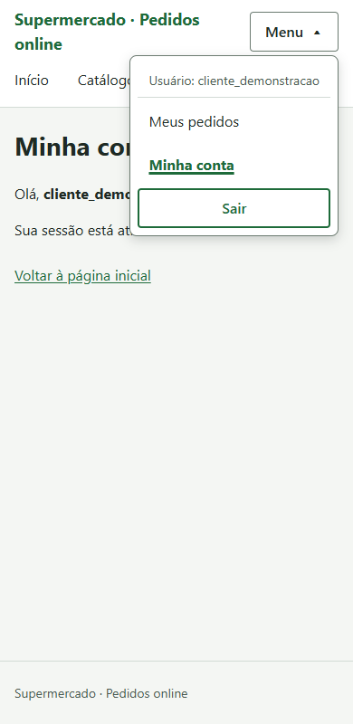

## 1. Página inicial

Abra o endereço do sistema no navegador. A página inicial mostra o título
**Sistema de Pedidos Online** e o botão **Ver catálogo de produtos**.

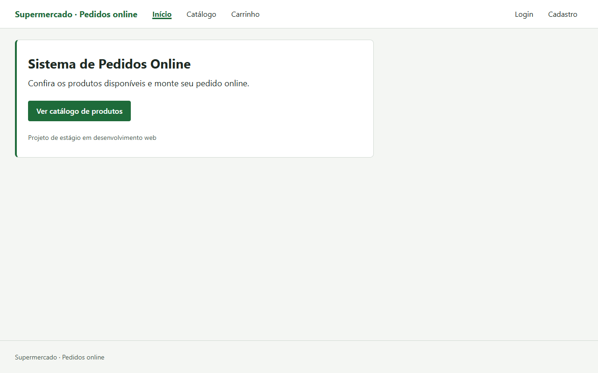

## 2. Catálogo sem cadastro

Clique em **Ver catálogo de produtos** ou no link **Catálogo**. Não é preciso ter conta para
consultar os produtos ou montar o carrinho.

Cada produto aparece em um cartão com nome, categoria, preço e unidade de venda (por exemplo,
"pacote 5 kg" ou "kg"). Os produtos aparecem em ordem alfabética.

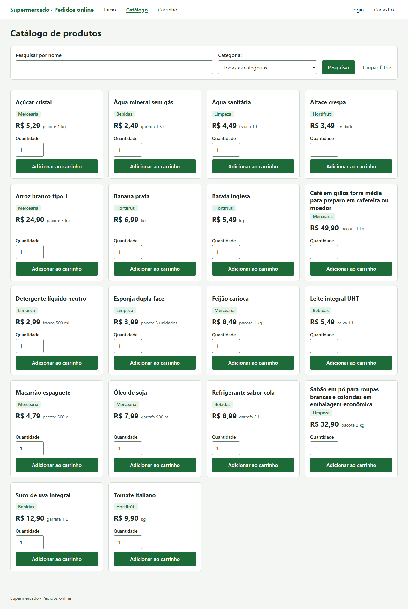

Em celulares, os cartões ficam em uma única coluna.

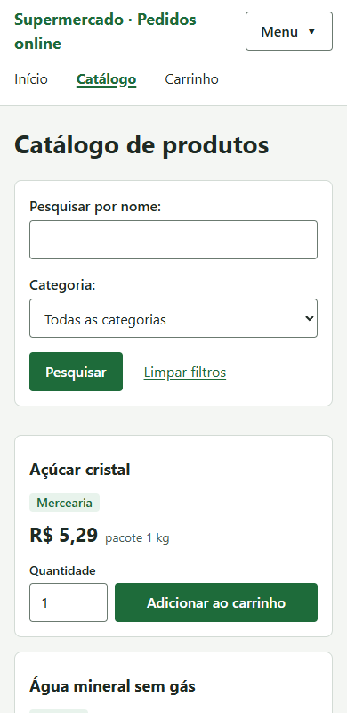

## 3. Pesquisa de produtos

No campo **Pesquisar por nome**, digite uma parte do nome e clique em **Pesquisar**. A pesquisa
não diferencia maiúsculas de minúsculas nem acentos:

- "agua", "água" e "ÁGUA" encontram "Água mineral sem gás" e "Água sanitária";
- "oleo" encontra "Óleo de soja";
- "feijao" encontra "Feijão carioca".

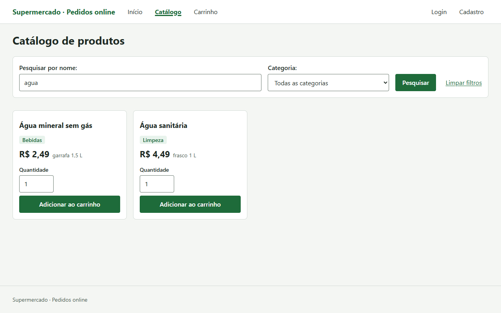

Quando nenhum produto corresponde à pesquisa, a página informa
**"Nenhum produto encontrado para os filtros informados."**. O link **Limpar filtros** volta ao
catálogo completo.

## 4. Filtro por categoria

No campo **Categoria**, escolha uma categoria (por exemplo, **Limpeza**) e clique em
**Pesquisar**. Para voltar a ver todas, escolha **Todas as categorias**.

A pesquisa por nome e o filtro por categoria podem ser usados juntos: por exemplo, "agua" com
a categoria **Limpeza** mostra apenas "Água sanitária".

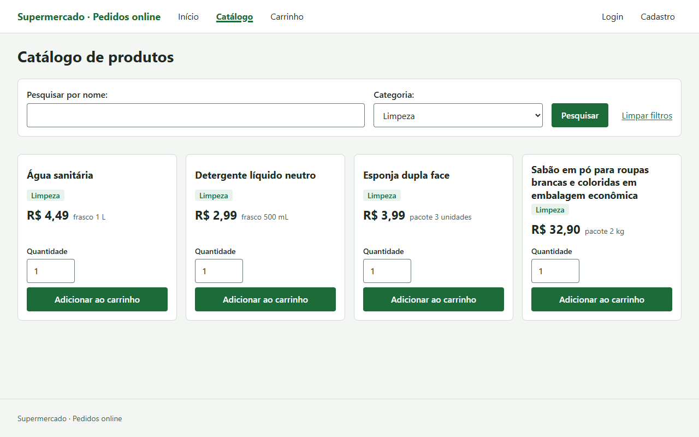

## 5. Detalhes do produto

Clique no nome de um produto para abrir seus detalhes: categoria, unidade e preço. Nesta
página também é possível informar a quantidade e clicar em **Adicionar ao carrinho**. O link
**Voltar ao catálogo** retorna à lista.

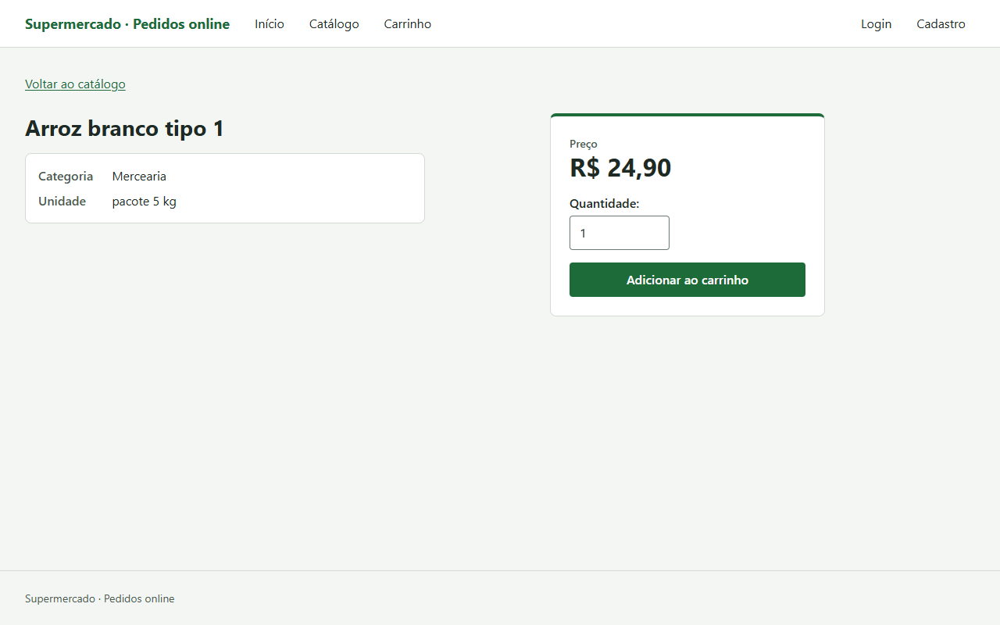

## 6. Criação de conta

Para finalizar uma compra é preciso ter uma conta. Clique em **Cadastro**. A página
**Criar conta** pede:

- **Usuário:** até 150 caracteres; letras, números e @/./+/-/_ apenas;
- **Senha** e **Confirmação de senha**.

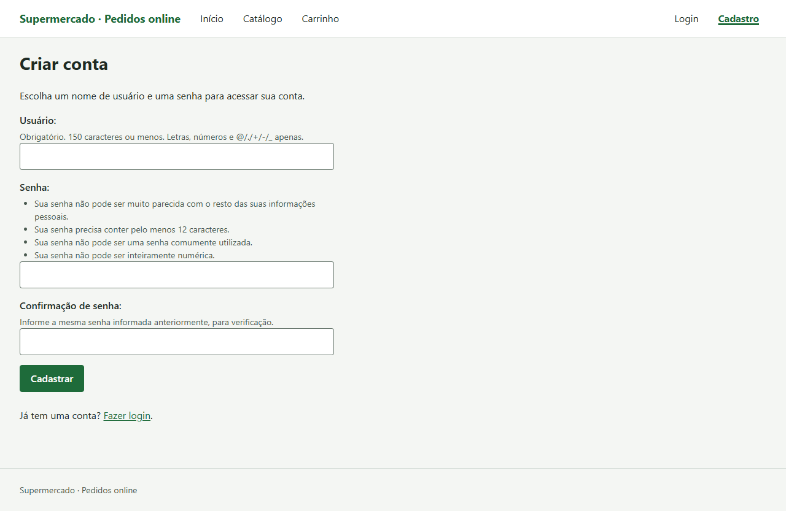

A senha precisa:

- ter **pelo menos 12 caracteres**;
- não ser muito parecida com o nome de usuário;
- não ser uma senha comum;
- não ser formada somente por números.

Símbolos ou letras maiúsculas não são obrigatórios. Se a senha não atender a uma dessas
regras, a página explica o motivo, por exemplo:
**"Esta senha é muito curta. Ela precisa conter pelo menos 12 caracteres."**.

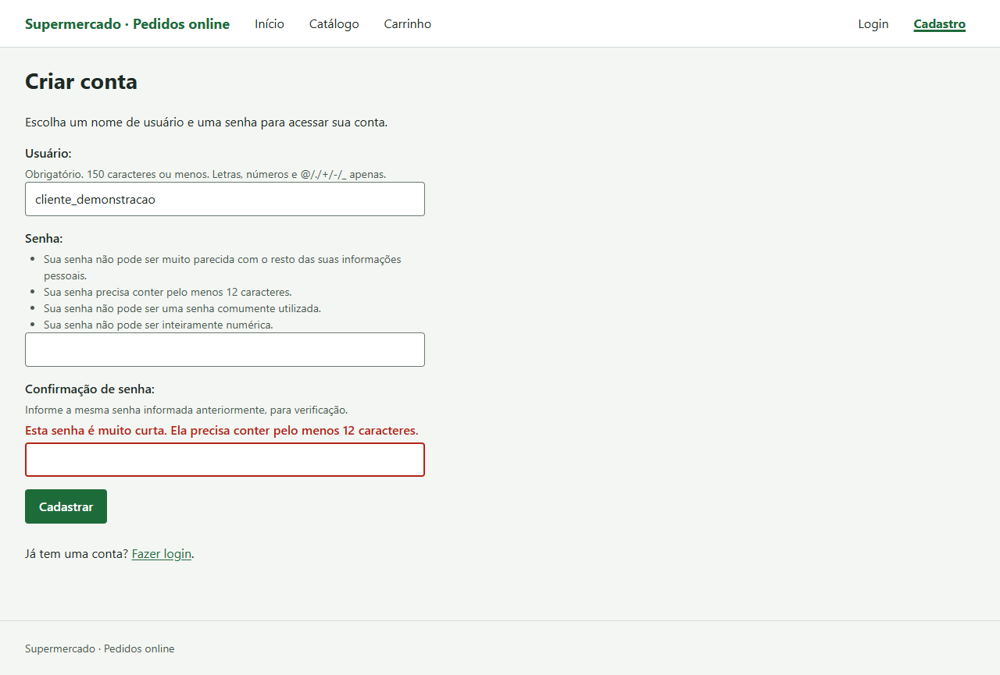

Ao clicar em **Cadastrar** com dados válidos, aparece
**"Cadastro realizado com sucesso. Entre com seu usuário e senha."** e a página de login é
aberta. O cadastro não faz login automaticamente. A conta criada é sempre uma conta de cliente,
sem acesso às funções da equipe do supermercado.

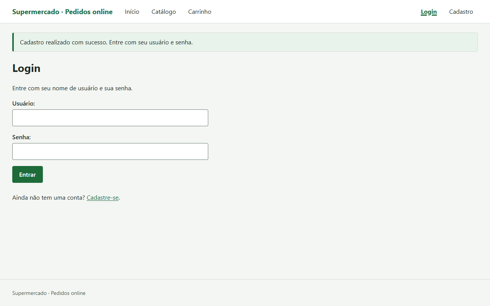

## 7. Login

Na página **Login**, informe **Usuário** e **Senha** e clique em **Entrar**. O sistema abre a
página **Minha conta**, que mostra o nome do usuário conectado.

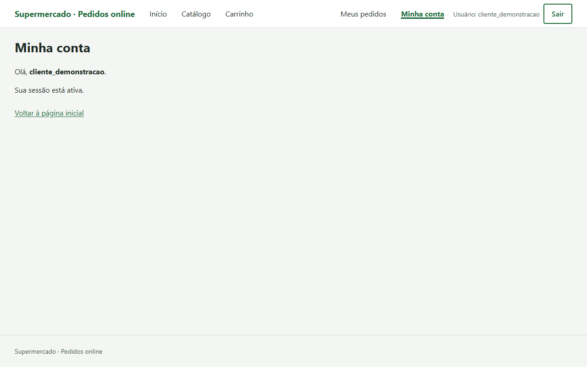

- **Dados incorretos:** aparece **"Por favor, entre com um usuário e senha corretos. Note que
  ambos os campos diferenciam maiúsculas e minúsculas."**.
- **Muitas tentativas erradas seguidas:** o acesso fica bloqueado temporariamente, com a
  mensagem **"Muitas tentativas de acesso. Aguarde alguns minutos e tente novamente."**. O
  bloqueio termina sozinho depois de alguns minutos.
- **Carrinho já montado:** os produtos adicionados antes do login continuam no carrinho.

## 8. Adicionar produtos ao carrinho

No catálogo ou nos detalhes do produto, informe a **Quantidade** (inicialmente 1) e clique em
**Adicionar ao carrinho**. O carrinho é aberto com a mensagem
**"<nome do produto> adicionado ao carrinho."**.

Adicionar de novo um produto que já está no carrinho soma as quantidades na mesma linha.

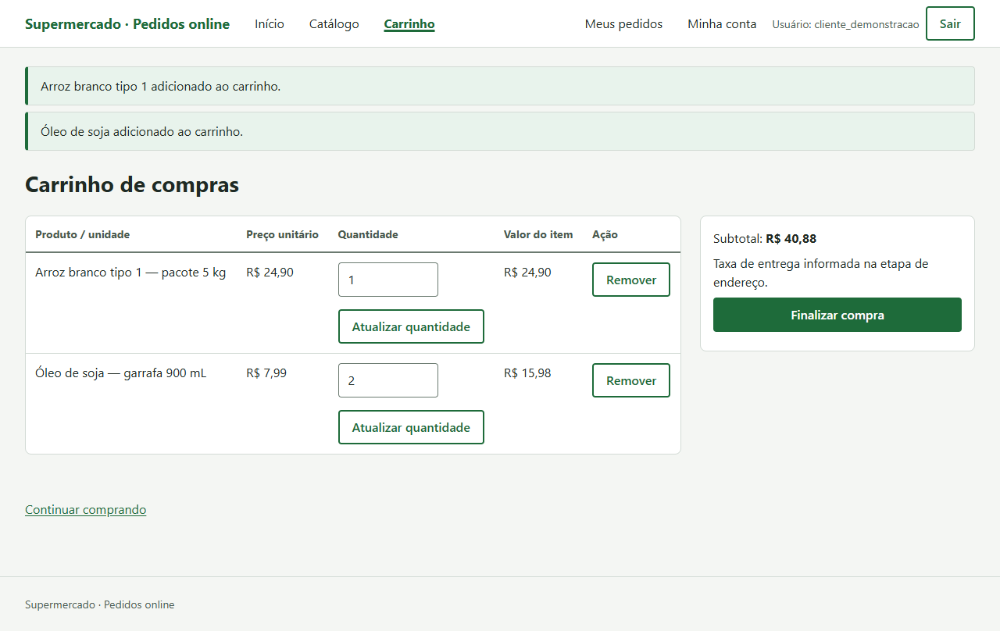

A página **Carrinho de compras** mostra, para cada produto:

- **Produto / unidade**;
- **Preço unitário**;
- **Quantidade**;
- **Valor do item**;
- o botão **Remover**.

Em celulares, cada produto aparece em um bloco próprio.

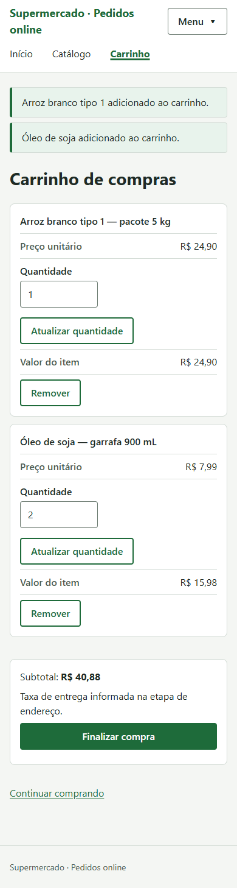

## 9. Alterar quantidades

Digite a nova quantidade no campo do produto e clique em **Atualizar quantidade**. Aparece
**"Quantidade atualizada."** e os valores são recalculados.

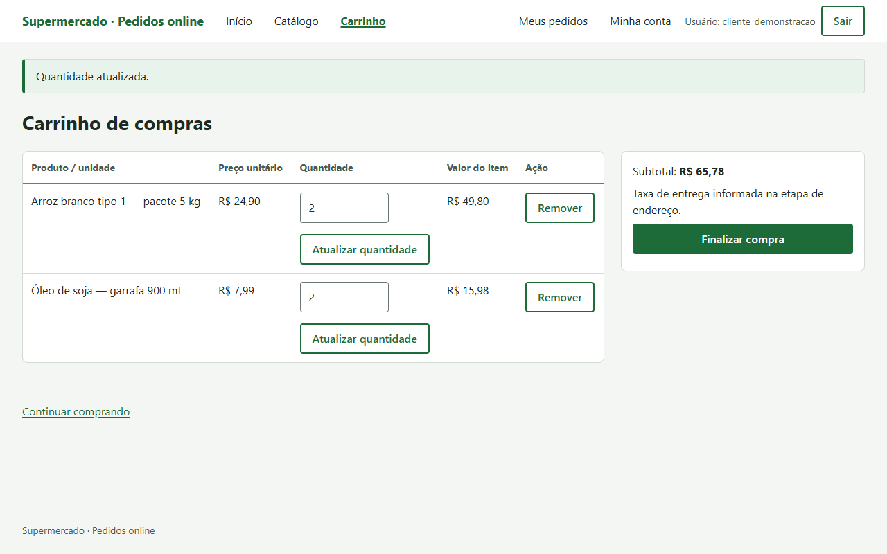

A quantidade deve ser um número inteiro maior que zero. Zero, números negativos, frações ou
texto são recusados com **"Informe uma quantidade inteira maior que zero."**, e a quantidade
anterior é mantida. Para tirar um produto do carrinho, use **Remover**.

## 10. Remover produtos

Clique em **Remover** na linha do produto. Aparece **"Item removido do carrinho."** e o subtotal
é recalculado. Se todos os produtos forem removidos, a página mostra
**"Seu carrinho está vazio."**.

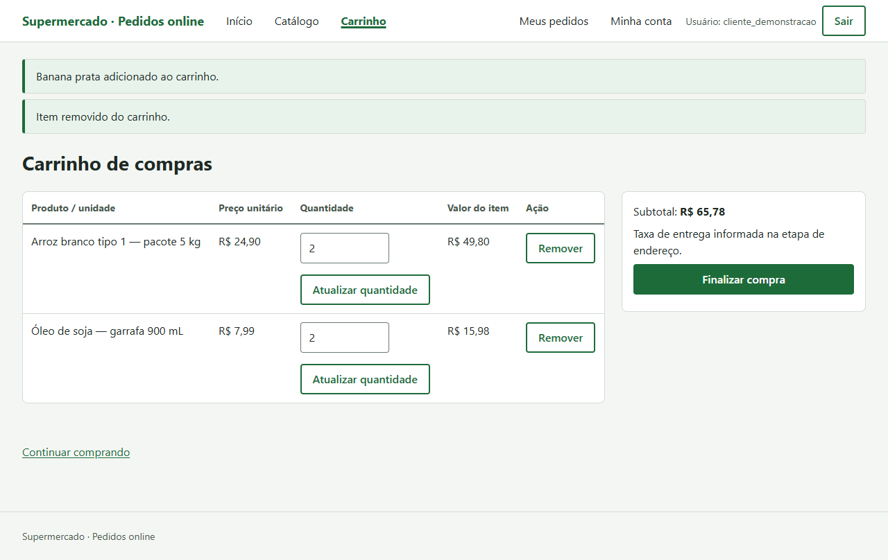

## 11. Conferir o subtotal

Abaixo dos produtos aparece o **Subtotal**, que é a soma dos valores dos itens. O texto
**"Taxa de entrega informada na etapa de endereço."** indica que a taxa só é somada na etapa
seguinte.

Para continuar, clique em **Finalizar compra**. Se você ainda não entrou na sua conta, o
sistema pede o login e, depois dele, volta para a finalização com o carrinho preservado.

## 12. Endereço de entrega

A página **Finalizar compra** mostra, em **Revise seu pedido**, os produtos, as quantidades e
os valores. Ao lado (ou abaixo, em celulares), em **Endereço e entrega**, preencha:

- **Logradouro**;
- **Número**;
- **Complemento (opcional)**;
- **Bairro**;
- **Telefone**.

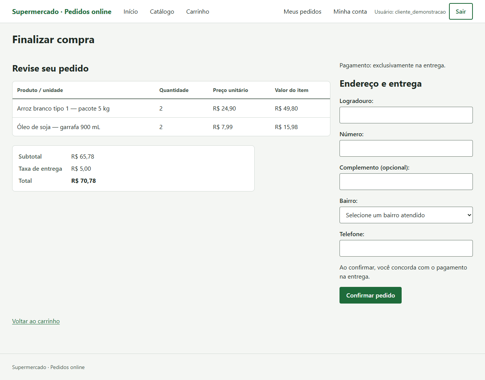

Se algum campo obrigatório ficar vazio, ele é destacado com a mensagem
**"Preencha este campo obrigatório."** e nenhum pedido é registrado. Os dados já digitados são
mantidos para correção.

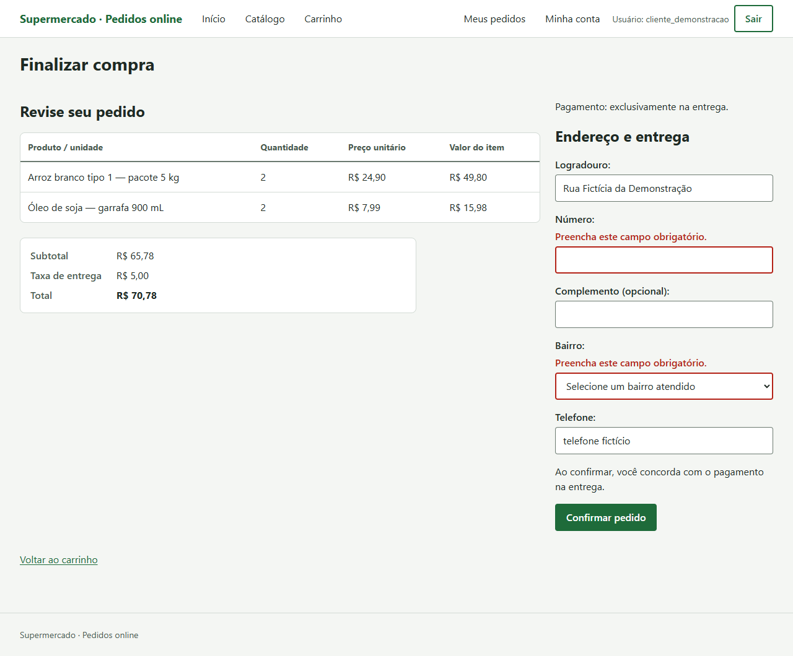

## 13. Escolha do bairro

No campo **Bairro**, abra a lista **Selecione um bairro atendido** e escolha
**Bairro Ficticio de Teste**. A entrega só é aceita para os bairros da lista.

> Nesta demonstração, **Bairro Ficticio de Teste** é o único bairro disponível e é um valor
> fictício. Ele não indica uma área de atendimento real.

## 14. Taxa de entrega e total

Em **Revise seu pedido** aparecem separadamente:

- **Subtotal**: soma dos itens;
- **Taxa de entrega**: R$ 5,00 nesta demonstração;
- **Total**: subtotal mais a taxa de entrega.

Os valores são sempre calculados pelo sistema. O pagamento é feito
**exclusivamente na entrega**, e o sistema não pede dados de cartão nem faz pagamento online.

O total de um pedido, já incluindo a taxa, não pode passar do limite configurado (R$ 5.000,00).
Acima disso, a página informa **"O valor total do pedido ultrapassa o limite de R$ 5000,00.
Ajuste o carrinho para continuar."**.

## 15. Confirmar o pedido

Depois de conferir os dados, clique em **Confirmar pedido**. O sistema registra o pedido,
esvazia o carrinho e abre a página **Pedido registrado**, com a mensagem
**"Pedido registrado com sucesso."**.

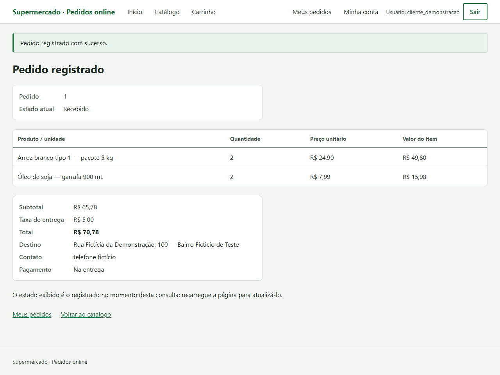

A página mostra:

- o número do pedido;
- o **Estado atual**, que em um pedido novo é sempre **Recebido**;
- os itens, os valores e o destino;
- o contato e a forma de **Pagamento** (**Na entrega**).

Algumas situações podem impedir o registro:

- **Valores alterados:** se um preço mudar entre a revisão e a confirmação, o sistema mostra
  **"Os valores foram atualizados. Confira antes de confirmar novamente."** e pede uma nova
  confirmação.
- **Clique repetido:** clicar de novo em **Confirmar pedido** não cria um segundo pedido.

## 16. Consultar e acompanhar o pedido

Clique em **Meus pedidos** para ver a lista dos seus pedidos, com **Pedido**, **Data**,
**Total registrado** e **Estado atual**. Somente os seus pedidos aparecem.

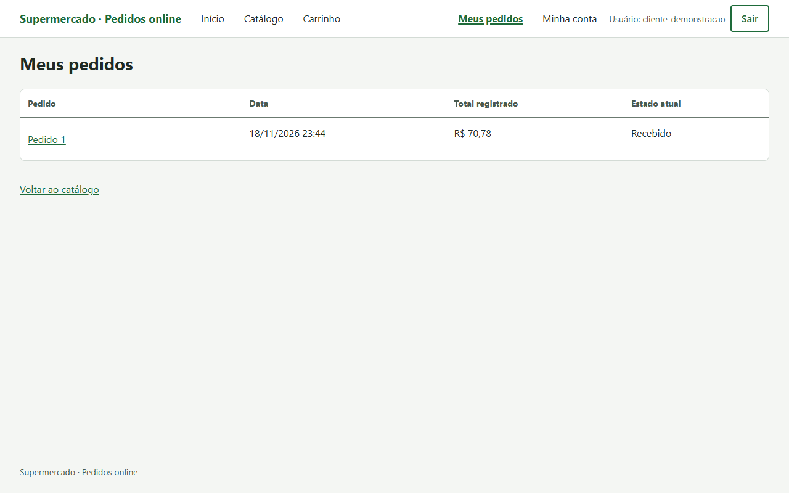

Clique no número do pedido para abrir o **Acompanhamento do pedido**, com os itens, os valores,
o destino e o estado.

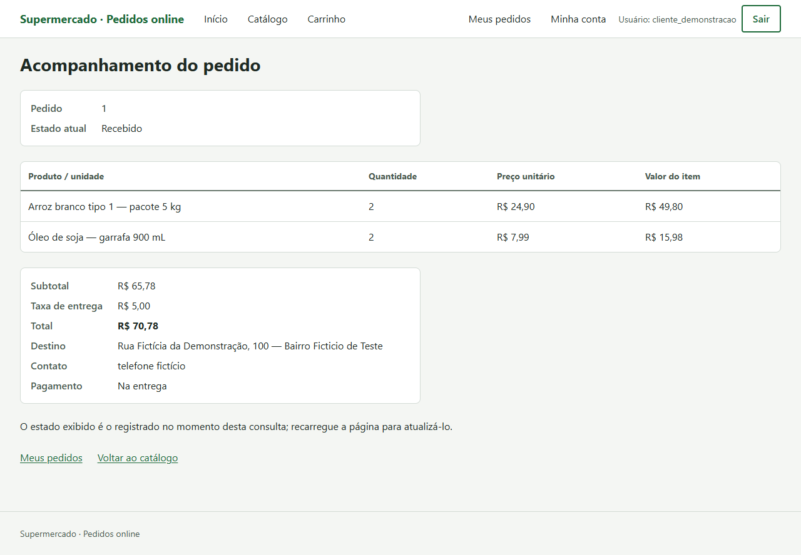

O estado do pedido é alterado pela equipe do supermercado:

- **Recebido**;
- **Confirmado**;
- **Em preparo**;
- **Saiu para entrega**;
- **Entregue** — ou **Cancelado**, se a equipe cancelar antes da saída para entrega.

O estado exibido é o registrado no momento da consulta. Para ver uma mudança, recarregue a
página. O sistema não envia notificações, não atualiza a página sozinho e não oferece
rastreamento da entrega. O cliente também não pode cancelar nem alterar um pedido pelo sistema.

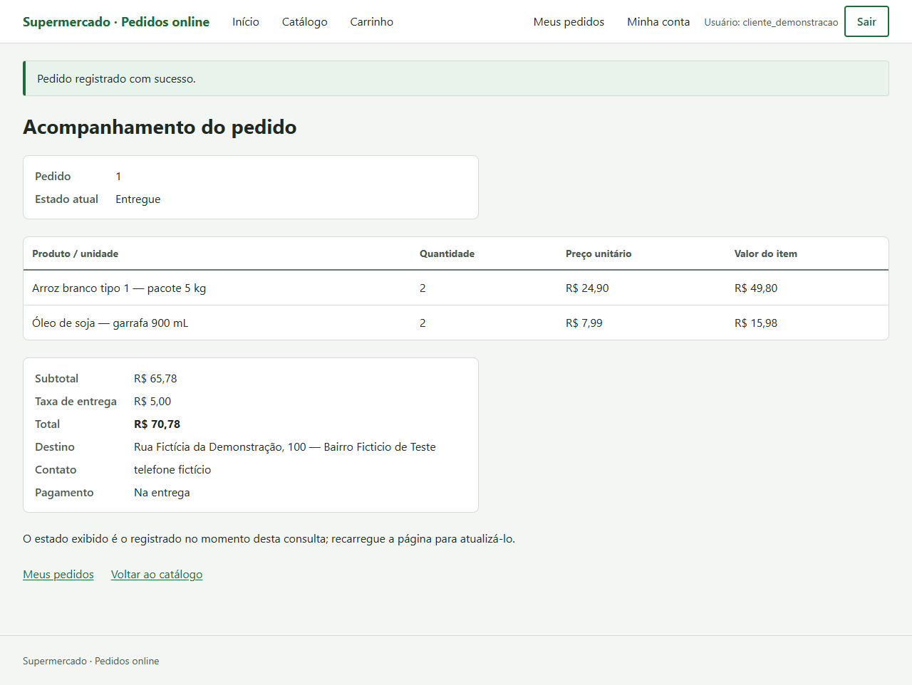

## 17. Sair da conta

Clique em **Sair**. Em celulares, o botão fica dentro de **Menu**. O sistema encerra a sessão,
volta à página inicial e esvazia o carrinho. Para ver os pedidos de novo, é preciso entrar
outra vez.

## 18. Dúvidas e mensagens frequentes

| Mensagem ou situação | O que significa |
|---|---|
| "Entre para consultar seus pedidos." | Você tentou abrir **Meus pedidos** sem estar conectado. Entre na conta para continuar. |
| "Pedido não encontrado ou acesso não permitido." | O pedido não existe ou pertence a outra pessoa. |
| "Há produto indisponível no carrinho. Remova o item para continuar." | Um produto do carrinho deixou de ser vendido. Remova-o para finalizar a compra. |
| "Este produto não está disponível." | O produto não está mais à venda. |
| "A entrega ainda não está disponível. Não é possível finalizar a compra no momento." | Não há bairros ou taxa de entrega configurados. Na demonstração eles estão configurados; essa mensagem aparece em uma instalação sem esses dados. |
| "Você não tem permissão para acessar esta área." | A página pertence à área da equipe do supermercado. |
