# Manual da equipe interna

**Sistema de Pedidos Online para Supermercado com Entrega**

Este manual explica como a equipe do supermercado consulta os pedidos recebidos e atualiza
seus estados no **Gerenciamento de pedidos**. Os nomes de páginas, botões e mensagens estão
escritos exatamente como aparecem no sistema.

> **Ambiente de demonstração acadêmica.** Os pedidos mostrados nas imagens usam dados fictícios
> (cliente, endereço, telefone, bairro **Bairro Ficticio de Teste** e taxa de R$ 5,00).
> Os estados registram etapas do atendimento: o sistema não executa nem acompanha a logística
> física da entrega.

As imagens deste manual foram capturadas do próprio sistema em execução, com dados fictícios.

## Sumário

1. [Acesso com a conta da equipe](#1-acesso-com-a-conta-da-equipe)
2. [Abrir o gerenciamento de pedidos](#2-abrir-o-gerenciamento-de-pedidos)
3. [Lista de pedidos](#3-lista-de-pedidos)
4. [Detalhes de um pedido](#4-detalhes-de-um-pedido)
5. [Confirmar um pedido](#5-confirmar-um-pedido)
6. [Iniciar o preparo](#6-iniciar-o-preparo)
7. [Registrar a saída para entrega](#7-registrar-a-saída-para-entrega)
8. [Concluir a entrega](#8-concluir-a-entrega)
9. [Cancelar um pedido](#9-cancelar-um-pedido)
10. [Estados e transições permitidas](#10-estados-e-transições-permitidas)
11. [Sair da conta](#11-sair-da-conta)
12. [Mensagens e situações frequentes](#12-mensagens-e-situações-frequentes)

## Permissões necessárias

O acesso depende das permissões da conta e é verificado pelo sistema a cada página e a cada
ação, não apenas pela exibição de botões.

| O que a conta pode fazer | Requisitos da conta |
|---|---|
| Consultar a lista e os detalhes dos pedidos | Conta ativa, marcada como integrante da equipe (`is_staff`), com a permissão **Can view pedido** (`principal.view_pedido`) |
| Alterar o estado dos pedidos | Os mesmos requisitos e também a permissão **Can change pedido** (`principal.change_pedido`) |

Contas de clientes criadas pela página de cadastro nunca recebem essas permissões. A conta da
equipe é criada e autorizada pelo responsável técnico do sistema, com uma senha pessoal
definida no momento da criação ([manual de instalação, seção 9](manual-instalacao.md#9-conta-da-equipe)).
A operação diária não exige superusuário. Este manual não traz contas nem senhas de
demonstração.

## 1. Acesso com a conta da equipe

Abra a página **Login** pelo link no topo da página. Informe **Usuário** e **Senha** e clique em
**Entrar**.

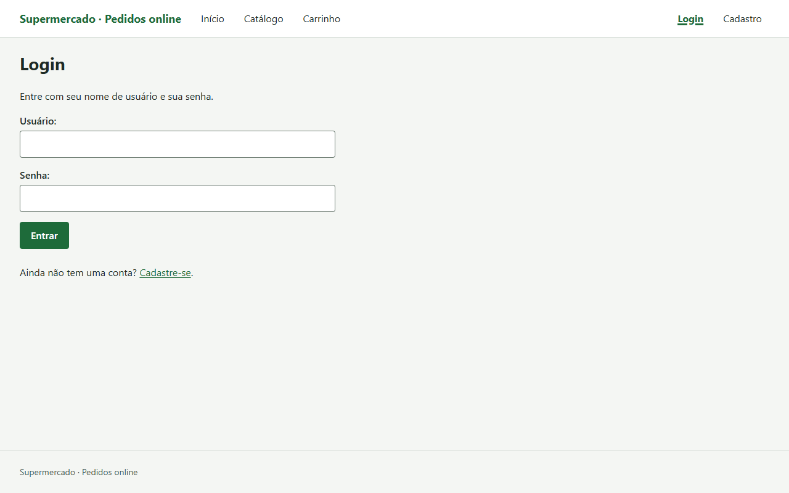

Depois de muitas tentativas erradas seguidas, o acesso é bloqueado temporariamente com a
mensagem **"Muitas tentativas de acesso. Aguarde alguns minutos e tente novamente."**. O
bloqueio termina sozinho depois de alguns minutos.

## 2. Abrir o gerenciamento de pedidos

Com uma conta da equipe autorizada, o topo da página mostra o link
**Gerenciamento de pedidos**. Em celulares, ele fica dentro do botão **Menu**.

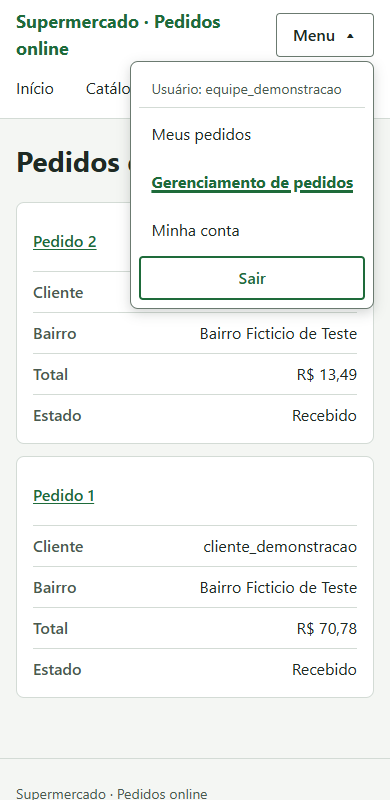

Contas sem a permissão necessária, inclusive as de clientes, não veem esse link. Se tentarem
abrir a página diretamente, recebem **"Você não tem permissão para acessar esta área."**.

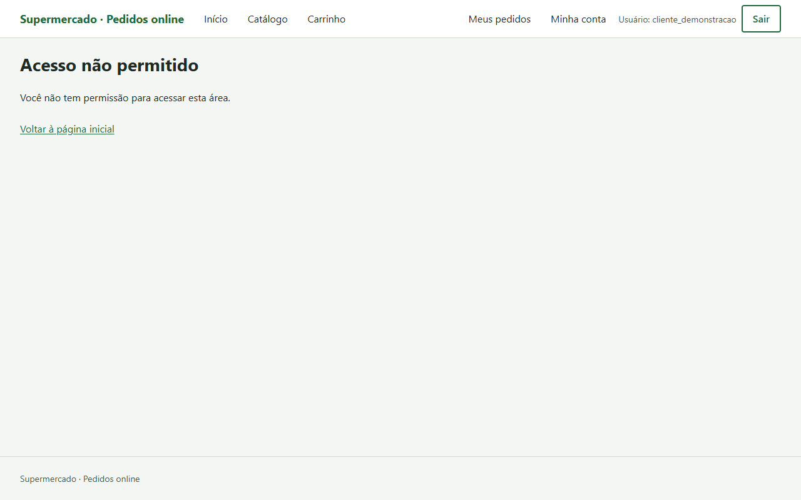

## 3. Lista de pedidos

A página **Pedidos do supermercado** lista todos os pedidos, do mais recente para o mais
antigo, com:

- **Pedido**;
- **Cliente**;
- **Bairro**;
- **Total**;
- **Estado**.

Clique em **Pedido N** para abrir os detalhes.

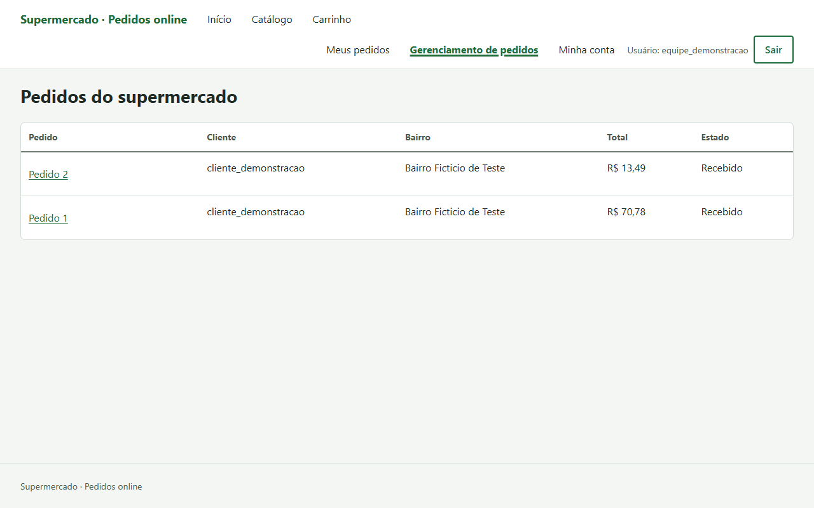

A lista mostra o estado registrado no momento em que a página foi aberta. Para ver pedidos novos
ou alterados, recarregue a página.

## 4. Detalhes de um pedido

A página do pedido mostra todos os dados necessários ao atendimento:

- **Data/hora**;
- **Cliente** e **Telefone**;
- **Logradouro**, **Número**, **Complemento** e **Bairro**;
- produtos, com quantidade, preço unitário e valor;
- **Subtotal**, **Taxa de entrega** e **Total**;
- **Pagamento** (**Na entrega**);
- **Estado atual**.

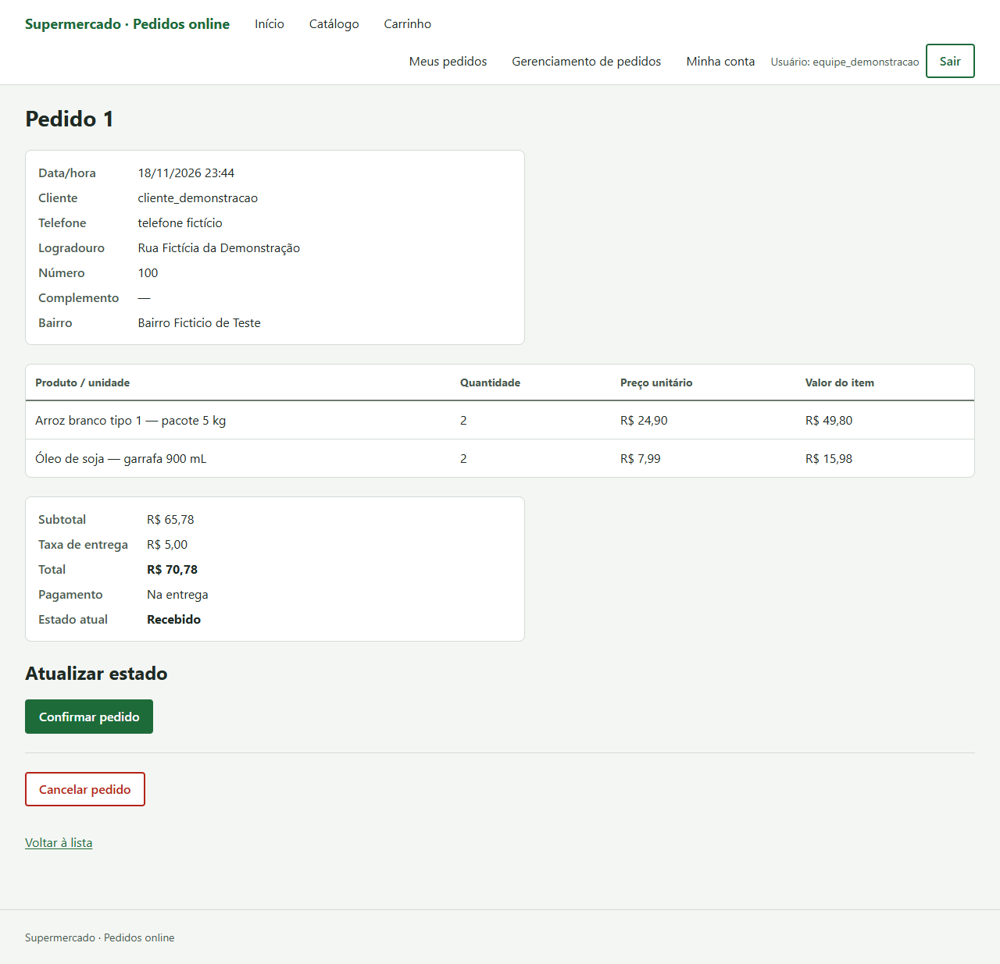

Os dados do pedido (itens, valores e endereço) não podem ser editados. Os preços são os
praticados no momento da compra, mesmo que o catálogo mude depois.

Na seção **Atualizar estado** aparecem somente as ações permitidas para o estado atual. A ação
**Cancelar pedido** fica separada das demais, com destaque em vermelho.

Contas que só podem consultar veem os mesmos dados, sem a seção **Atualizar estado**.

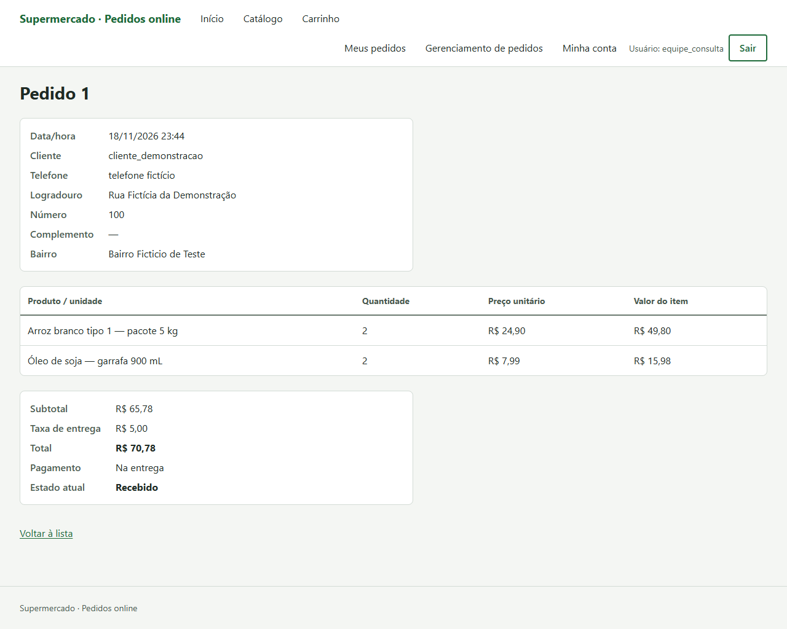

## 5. Confirmar um pedido

Todo pedido novo começa como **Recebido**. Depois de conferir os dados, clique em
**Confirmar pedido**. Aparece a mensagem **"Pedido N: Recebido → Confirmado."** e o estado passa a
**Confirmado**.

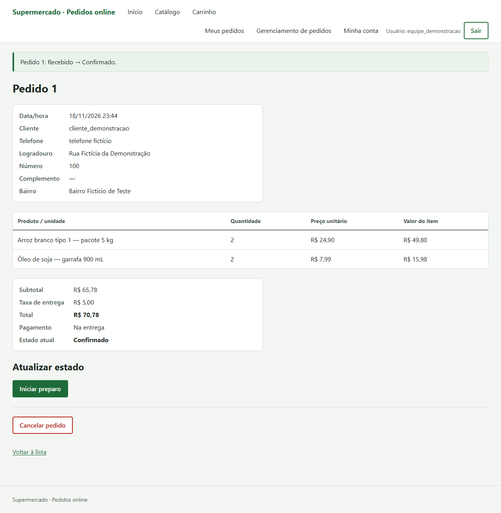

## 6. Iniciar o preparo

Com o pedido **Confirmado**, clique em **Iniciar preparo** para registrar o início da separação
dos produtos. O estado passa a **Em preparo**.

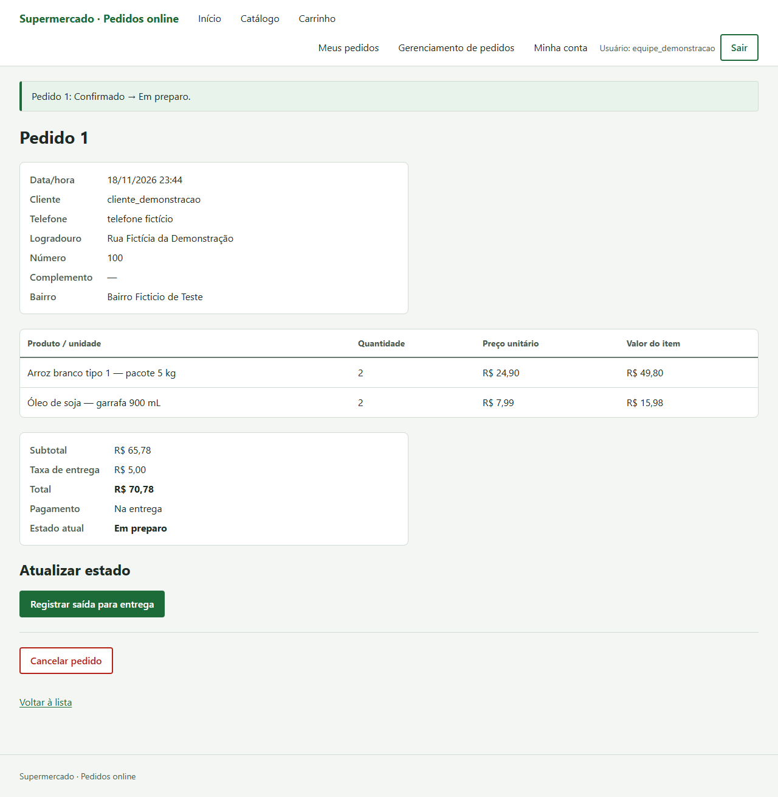

## 7. Registrar a saída para entrega

Com o pedido **Em preparo**, clique em **Registrar saída para entrega**. O estado passa a
**Saiu para entrega**. A partir deste ponto, o pedido não pode mais ser cancelado.

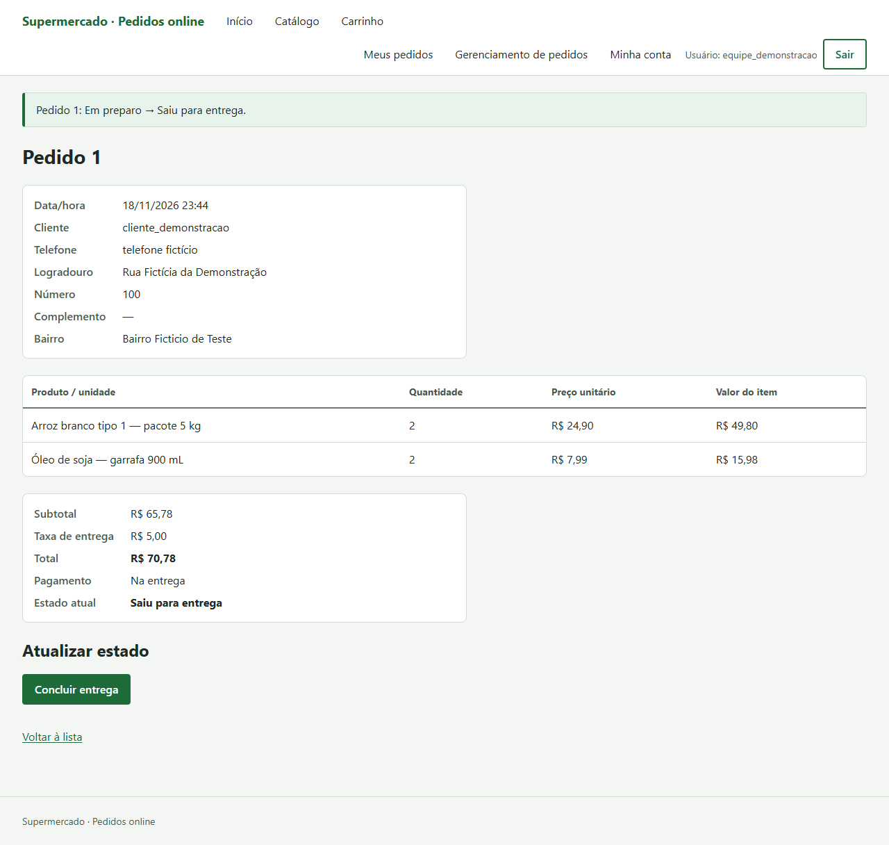

## 8. Concluir a entrega

Depois que a entrega for feita, clique em **Concluir entrega**. O estado passa a **Entregue**, e a
página informa **"Estado terminal: nenhuma alteração disponível."**.

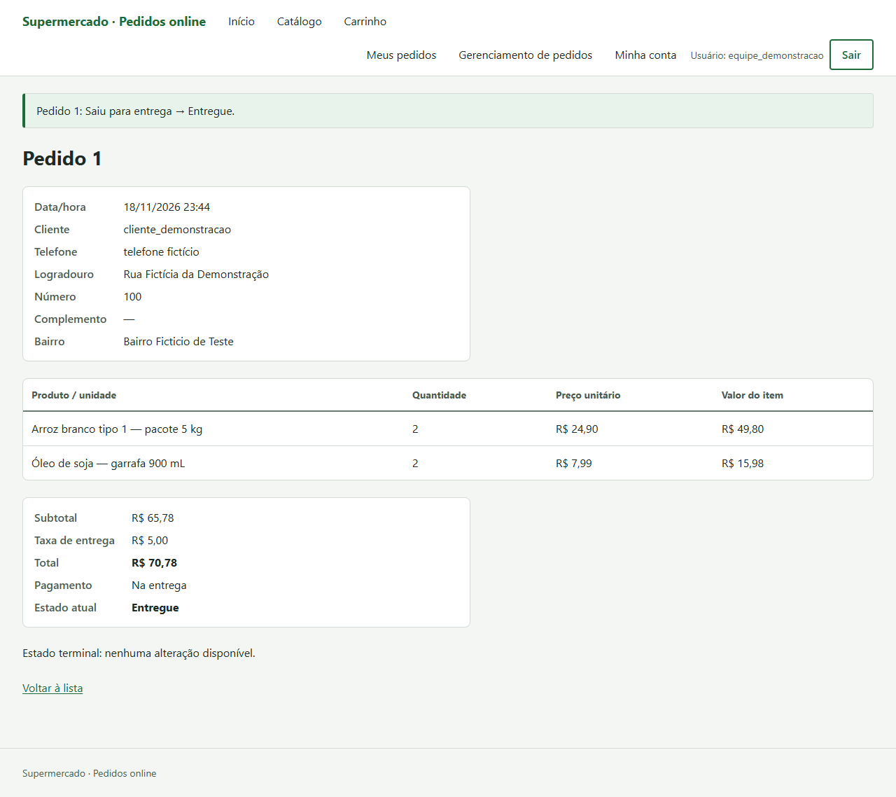

O sistema apenas registra a informação dada pela equipe: não confirma a entrega física, não
calcula rotas e não rastreia o entregador.

## 9. Cancelar um pedido

Use **Cancelar pedido** somente quando o pedido não for atendido. O cancelamento é permitido
nos estados **Recebido**, **Confirmado** e **Em preparo**; ele não está disponível depois de
**Saiu para entrega**.

> **Atenção:** o cancelamento é imediato e definitivo. Não há pedido de confirmação adicional,
> e um pedido **Cancelado** não pode ser reaberto.

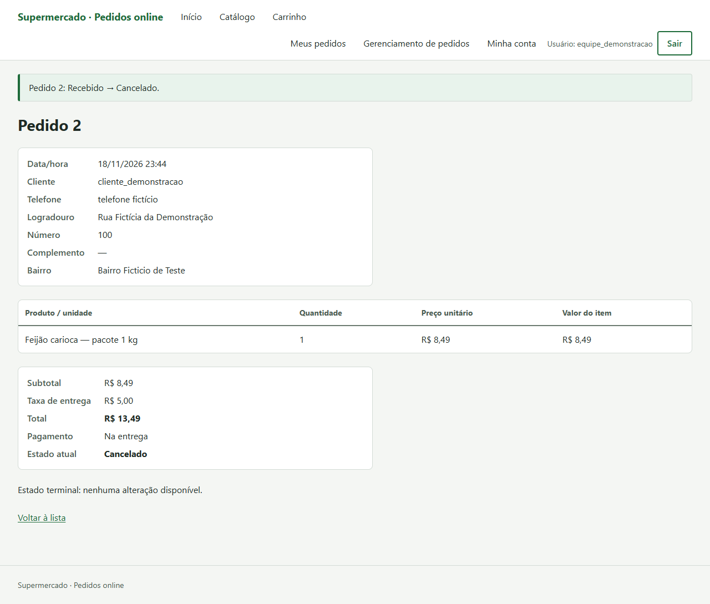

O pedido cancelado continua registrado, com seus itens e valores, para consulta. O cliente vê o
estado **Cancelado** ao abrir ou recarregar o acompanhamento do pedido.

## 10. Estados e transições permitidas

| Estado | Significado | Ações disponíveis |
|---|---|---|
| **Recebido** | Pedido registrado pelo cliente; estado inicial de todo pedido. | **Confirmar pedido**, **Cancelar pedido** |
| **Confirmado** | A equipe conferiu os dados e aceitou atender o pedido. | **Iniciar preparo**, **Cancelar pedido** |
| **Em preparo** | A separação dos produtos foi iniciada. | **Registrar saída para entrega**, **Cancelar pedido** |
| **Saiu para entrega** | O pedido foi encaminhado para entrega. | **Concluir entrega** |
| **Entregue** | A equipe registrou a conclusão da entrega. Estado final. | Nenhuma |
| **Cancelado** | A equipe cancelou o pedido antes da saída para entrega. Estado final. | Nenhuma |

Não é possível pular etapas, voltar a um estado anterior nem alterar um pedido **Entregue** ou
**Cancelado**. Essas regras são verificadas pelo sistema mesmo que alguém tente enviar a ação por
outro meio.

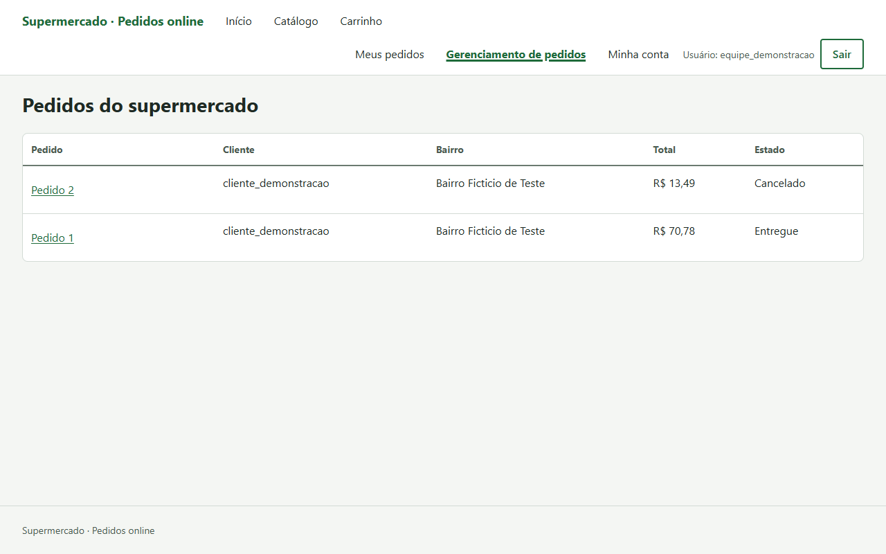

O sistema guarda apenas o estado atual de cada pedido. Ele não registra quem fez cada alteração
nem o horário de cada mudança de estado.

## 11. Sair da conta

Clique em **Sair** no topo da página; em celulares, o botão fica dentro de **Menu**. A sessão é
encerrada e a página inicial é exibida. Em computadores compartilhados, saia sempre da conta ao
terminar o atendimento.

## 12. Mensagens e situações frequentes

| Mensagem | Significado e o que fazer |
|---|---|
| "Pedido N: <estado anterior> → <novo estado>." | A alteração foi registrada. |
| "O estado do pedido mudou. Atualize a consulta." | O pedido foi alterado depois que a página foi aberta (por exemplo, por outra pessoa da equipe ou por um clique repetido). Nada foi alterado pela sua ação. Confira o estado atual exibido antes de continuar. |
| "Esta alteração não é permitida para o estado atual." | A ação não é uma transição permitida (seção 10). O pedido não foi alterado. |
| "Não foi possível salvar a alteração." | Falha ao gravar. O pedido não foi alterado; tente novamente. |
| "Você não tem permissão para acessar esta área." | A conta não tem as permissões necessárias. Procure o responsável técnico. |

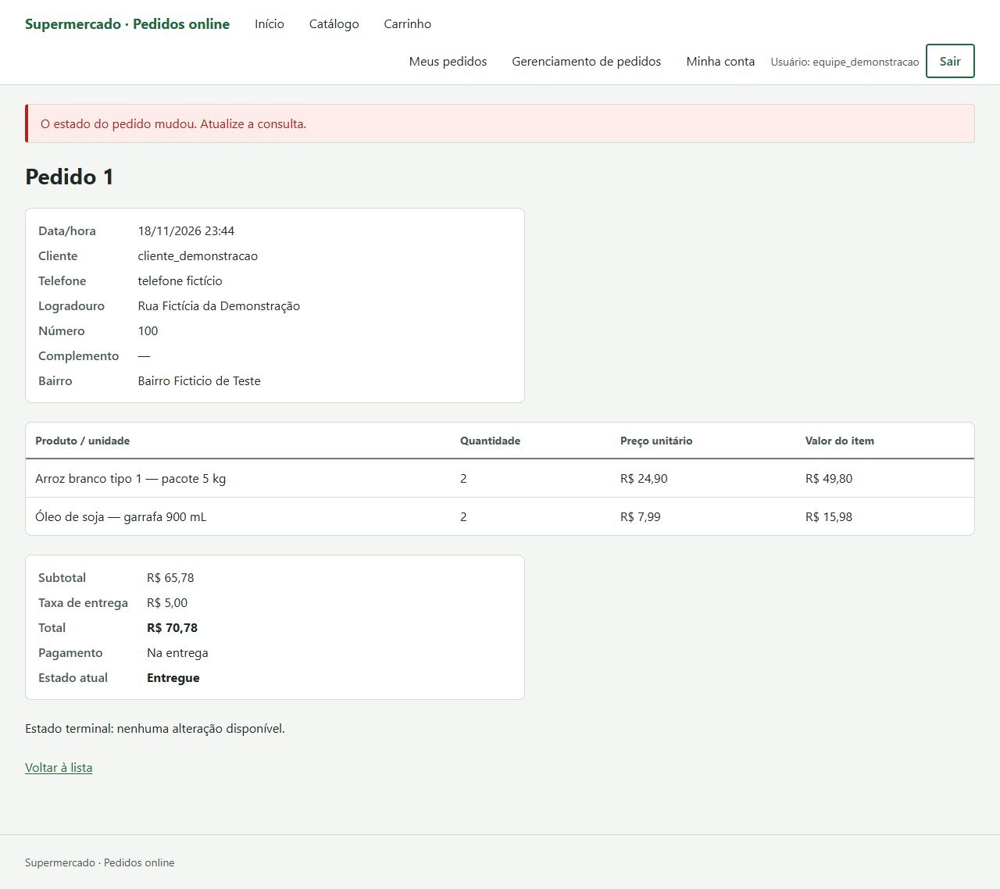

### Fora do escopo deste manual

O cadastro e a manutenção de categorias e produtos são feitos pelo Django Admin (`/admin/`). Para
isso a conta precisa de permissões próprias, que não fazem parte do gerenciamento de pedidos.
Pedidos não são editados pelo Django Admin.
